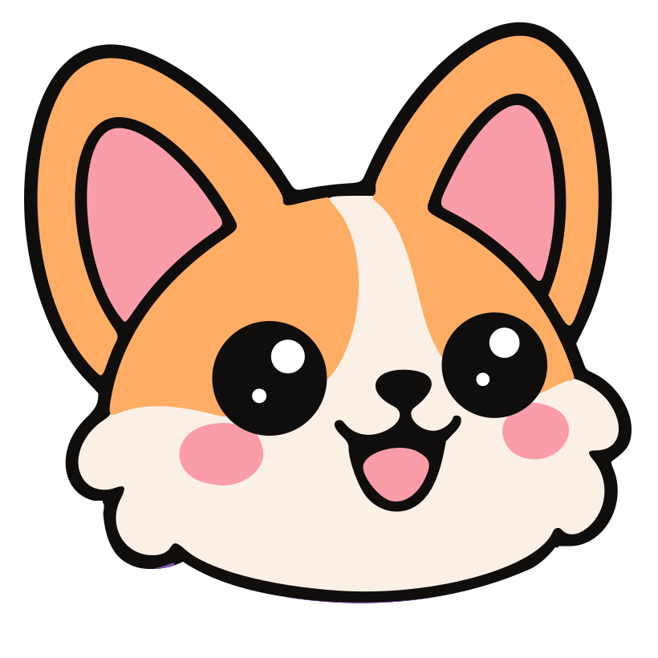

<h1> buddy-agent</h1>

Buddy Agent is a Go agent harness.

## Overview

Buddy runs as a command-line client backed by a local daemon. The daemon manages turns and tool execution, while the terminal UI handles conversation input, approvals, and session control.

## Features

- **Interactive terminal UI** for multi-turn conversations, approvals, slash commands, and reviewing working-tree changes.
- **One-shot tasks** for running a prompt from the command line without opening an interactive session.
- **Local daemon and session storage** so work can continue in the background and conversations can be resumed.
- **OpenAI-compatible model endpoints**, including local runners such as Ollama and hosted providers.
- **MCP and subagent support** for connecting external tools and delegating bounded tasks.
- **Workspace memory and context management** using project files and persisted conversation state.
- **Pure Go builds** for Linux, macOS, and Windows.

## Documentation

See the [documentation](docs/README.md) for the CLI, configuration, architecture, terminal UI, daemon, persistence, MCP, and subagent guides.

## Getting Started

### Prerequisites
- Go 1.25.4+
- An OpenAI-compatible API endpoint (local runner or provider)

### Setup

1. Copy the environment configuration:
   ```bash
   cp .env.example .env
   ```
2. Configure your API base URL, key, and model name in `.env`.
3. Build the binary:
   ```bash
   go build -o bin/buddy-agent ./cmd/buddy
   ```
4. Run:
   ```bash
   ./bin/buddy-agent
   ```
   This opens an interactive conversation when run in a terminal. Continue the latest conversation in the current workspace with:
   ```bash
   ./bin/buddy-agent --continue
   ```
   One-shot tasks remain available:
   ```bash
   ./bin/buddy-agent "Inspect the repository and run all tests"
   ```
