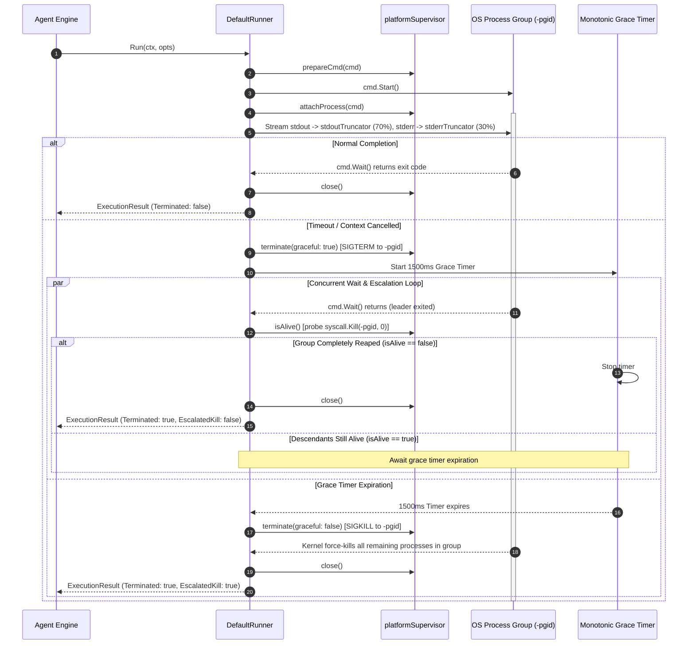

# Milestone 2: Subprocess Process Group Isolation & Output Safety

* **Author:** hoangndst
* **Status:** Approved
* **Date:** 2026-11-19

--------------------------------------------------------------------------------

## Overview

In autonomous agent systems running locally on developer workstations, executing shell commands (`bash`) is the primary interface between LLM reasoning and the host operating system. Commands must execute deterministically, respect timeouts, and terminate cleanly without leaving orphaned background processes, locked files, or exhausted memory.

Milestone 2 hardens `buddy-agent`'s subprocess execution layer by introducing operating system process group supervision, an escalated dual-phase termination protocol (`SIGTERM` -> 1.5s grace period -> `SIGKILL` to negative PGID) with descendant liveness probing, and a memory-bounded streaming line-aware head/tail output truncator.

## The Problem

The initial Milestone 1 harness implementation relied on standard Go `exec.CommandContext(ctx, "bash", "-c", cmd)` and buffered all standard output and error into unbounded in-memory byte buffers before applying post-execution string truncation. In multi-step developer workflows, this exposes three critical failure modes:

1. **Child Process & Socket Leaks (Orphan Problem)**: Go's `exec.CommandContext` sends `os.Kill` only to the immediate parent process (`bash`). Any child processes spawned by compilers, background servers, subshells, or pipelines (e.g., `go test`, `npm run dev`, `sleep 100 &`) are reparented to PID 1 (init/systemd/launchd). They continue executing indefinitely in the background, locking network ports (e.g., `EADDRINUSE: port 8080 already in use`), holding open file handles, and causing non-deterministic collisions across agent turns.
2. **Host Heap Exhaustion (OOM Panics)**: Runaway commands (such as `cat /dev/urandom`, `find /`, or accidental infinite loops) write unbounded output into harness memory. A process emitting gigabytes of logs will trigger an OS OOM kill (`SIGKILL`) of the agent harness itself before post-execution truncation can execute.
3. **Mangled Diagnostic Context**: Hard character or byte truncation slices through multi-byte UTF-8 runes (producing invalid `\uFFFD` characters) and splits critical compiler errors or panics midway through lines. Furthermore, because diagnostics invariably print at the tail of stdout/stderr, arbitrary truncation that favors the head drops the exact error messages the agent requires to diagnose failures.

## Goals

* **Zero Leaked Child Processes**: Guarantee that when a command times out or its context is cancelled, all descendant processes spawned in the process group are completely eliminated. Verification uses direct OS process-group probing (`syscall.Kill(-pgid, 0) == ESRCH`) rather than brittle external utilities.
* **Escalated Dual-Phase Termination with Asynchronous Liveness Probing**: Provide a graceful termination window (`SIGTERM`) allowing build tools and databases to flush buffers and release file locks. The supervisor coordinates `cmd.Wait()` and a 1.5s grace timer via an asynchronous `select` loop: even if the group leader or children trap `SIGTERM`, escalation to `SIGKILL` to `-pgid` strictly executes upon grace timer expiration.
* **Strict Heap Memory Ceiling**: Guarantee $O(\text{budget})$ maximum heap allocation during command execution using a streaming line-aware sink implementing `io.Writer`, preventing harness OOM crashes regardless of command output volume.
* **Dual-Stream Resource Allocation**: Dedicate independent truncators for `stdout` (70% budget) and `stderr` (30% budget) to prevent data races and stream interleaving, while reserving omission marker overhead (~120 bytes) to strictly preserve `len(result) <= maxOutputBytes`.
* **Line-Aware Context Preservation with Delimiter-Free Fallback**: Retain head and tail output aligned to newline (`\n`) boundaries. If output lacks newline delimiters (minified JSON, single long lines), gracefully fall back to valid UTF-8 rune boundaries.
* **Zero CGO & Unified Cross-Platform Contract**: Implement all functionality in pure Go, using a unified internal `platformSupervisor` interface implemented across POSIX systems (`//go:build !windows`) and Windows Job Objects (`//go:build windows`).

## Non-Goals

* **Interactive Pseudo-Terminal (PTY) Emulation**: Subprocesses run headlessly with standard input closed (`cmd.Stdin = nil` / `/dev/null`). Interactive prompts (`sudo`, `read -p`, unauthenticated prompts) fail immediately with EOF rather than blocking the agent.
* **Containerized MicroVM / Sandbox Hypervisors**: Execution remains bare-metal process group supervision on the host OS; containerization (Docker, gVisor, Firecracker) is out of scope for local-first execution.
* **Adversarial `setsid()` Sandbox Escapes**: Bare-metal process group supervision operates via POSIX process groups. If a child command intentionally executes `setsid()` or alters its PGID, it detaches from the supervised process group. Guarding against deliberate adversarial kernel escapes requires cgroups or containers, which is an explicit non-goal.
* **Context Compaction & Memory Pruning**: Prompt token reduction and conversation history compaction are handled in Milestone 3.
* **Model Context Protocol (MCP) Process Supervision**: Managing external MCP server stdio lifecycles is handled in Milestone 4 (which will build on the subprocess primitives established in Milestone 2).

## Open Questions

* **Question 1 (Resolved in Review)**: *How to prevent premature grace timer cancellation when the group leader (`bash`) exits before its children?*  
  **Resolution**: `cmd.Wait()` reaps only `bash`. When termination is active, `DefaultRunner` probes the process group using `platformSupervisor.isAlive()` (which calls `syscall.Kill(-pgid, 0)`). If descendants remain alive, the 1.5s grace timer remains active and escalates to `SIGKILL` upon expiration. Escalation is disarmed only when the entire group returns `ESRCH`.
* **Question 2 (Resolved in Review)**: *How to prevent data races between concurrent stdout and stderr streaming?*  
  **Resolution**: `DefaultRunner` instantiates two independent `StreamingLineTruncator` instances—allocating 70% of the byte budget to `stdout` and 30% to `stderr`—and merges them deterministically post-execution.
* **Question 3 (Resolved in Review)**: *How to handle Windows platform parity without CGO?*  
  **Resolution**: Define a unified internal `platformSupervisor` interface. On Windows, use `CreationFlags: windows.CREATE_SUSPENDED`, assign the process to a Windows Job Object configured with `JOB_OBJECT_LIMIT_KILL_ON_JOB_CLOSE`, and resume the thread.

## Critical User Journeys (CUJs)

### CUJ 1: Clean Termination of Runaway Processes Trapping SIGTERM
* **Given**: An agent executes a command that spawns a background child process that explicitly traps or ignores `SIGTERM` (`bash -c 'trap "" SIGTERM; sleep 100 &'`) with a 2-second command timeout.
* **When**: The 2-second execution deadline expires. `SIGTERM` is sent to the process group. The bash leader exits immediately, but the child process ignores the signal.
* **Then**: The supervisor observes that the group leader exited via `cmd.Wait()`, probes the group via `isAlive()`, confirms descendant processes are still active, and maintains the 1.5s grace timer. When the timer expires, it broadcasts `SIGKILL` to `-pgid`, reaps the rogue child, and confirms `isAlive() == false`. The tool returns `Exit Code: -1` and `Status: Terminated (Timeout: 2s, SIGKILL Escalated)`.

### CUJ 2: Memory-Bounded Streaming of Delimiter-Free Output
* **Given**: An agent executes a command producing continuous output lacking newline characters (e.g., minified JSON or `cat /dev/urandom | base64 | tr -d '\n'`) against a 10KB output budget (`MaxOutputBytes: 10000`).
* **When**: The command produces 50MB of data before completing or being terminated.
* **Then**: Harness memory footprint remains strictly flat ($O(\text{budget})$). The truncator's fallback logic detects the absence of newlines and slices cleanly on UTF-8 rune boundaries rather than collapsing to empty text. The returned output contains complete valid runes, an omission marker reporting omitted byte count, and total output length strictly $\le 10,000$ bytes.

### CUJ 3: Cross-Platform Parity on Windows
* **Given**: `buddy-agent` runs on Windows and executes a build script spawning background child processes.
* **When**: The command times out or context is cancelled.
* **Then**: The Windows `platformSupervisor` closes the Job Object handle, instructing the Windows kernel to terminate all assigned processes without leaking background child processes.

--------------------------------------------------------------------------------

## Technical Plan (Architecture)

### 1. Architectural Component Decomposition

Milestone 2 introduces a dedicated package: `internal/tools/subprocess`. This ensures process lifecycle supervision, signal handling, and stream truncation remain isolated from higher-level tool logic.

```mermaid
flowchart TD
    subgraph Agent Runtime
        A["Agent Engine"] --> B["BashTool (internal/tools/bash.go)"]
        CLI["cmd/buddy/main.go"] --> B
    end

    subgraph Subprocess Package (internal/tools/subprocess)
        B --> C["Runner Interface"]
        C --> D["DefaultRunner (process.go)"]
        D --> E["platformSupervisor Interface"]
        E --> F["posixSupervisor (process_unix.go)"]
        E --> G["windowsSupervisor (process_windows.go)"]
        D --> H["stdoutTruncator (buffer.go - 70% budget)"]
        D --> I["stderrTruncator (buffer.go - 30% budget)"]
    end

    subgraph Host Operating System
        F --> J["Process Group (-PGID)"]
        G --> K["Windows Job Object"]
        J --> L["bash leader"]
        J --> M["compiler / child"]
        J --> N["background forks"]
        L -->|"stdout pipe"| H
        L -->|"stderr pipe"| I
    end
```

### 2. Core Interfaces and Data Types

In `internal/tools/subprocess/process.go`:

```go
package subprocess

import (
	"context"
	"os/exec"
	"time"
)

// ExecutionResult encapsulates the outcome of a supervised command execution.
type ExecutionResult struct {
	ExitCode       int           // Process exit code (0 for success, non-zero for command failures, -1 for terminated)
	Stdout         string        // Line-aware truncated standard output
	Stderr         string        // Line-aware truncated standard error
	Combined       string        // Formatted summary string containing exit status, duration, and output
	Terminated     bool          // True if process was terminated by timeout or context cancellation
	EscalatedKill  bool          // True if process group required SIGKILL escalation
	Duration       time.Duration // Wall-clock execution duration
	OmittedLines   int           // Total lines omitted across stdout and stderr
	OmittedBytes   int64         // Total bytes omitted across stdout and stderr
}

// ExecutionOptions specifies execution parameters for the subprocess runner.
type ExecutionOptions struct {
	Command        string        // Command string to execute via shell
	Dir            string        // Working directory for execution
	Timeout        time.Duration // Maximum execution duration before triggering termination
	GracePeriod    time.Duration // Grace period between SIGTERM and SIGKILL (defaults to 1500ms)
	MaxOutputBytes int           // Maximum byte capacity for output (defaults to 10000)
	Env            []string      // Optional environment variables (nil = inherit os.Environ())
}

// Runner defines the contract for supervised subprocess execution.
// It returns (*ExecutionResult, nil) for any command successfully started by the OS
// (including non-zero exits and timeouts). Non-nil error is returned only for OS launch failures.
type Runner interface {
	Run(ctx context.Context, opts ExecutionOptions) (*ExecutionResult, error)
}

// platformSupervisor defines the unified cross-platform OS process management contract.
type platformSupervisor interface {
	prepareCmd(cmd *exec.Cmd) error
	attachProcess(cmd *exec.Cmd) error
	terminate(graceful bool) error
	isAlive() bool
	close() error
}
```

---

### 3. Process Group Lifecycle & Escalated Termination Protocol



#### Detailed Execution Protocol:
1. **Process Group Establishment**:
   - `prepareCmd`: On POSIX (`process_unix.go`), sets `cmd.SysProcAttr = &syscall.SysProcAttr{Setpgid: true}`. The child becomes process group leader (`PGID == PID`) before `execve`.
   - `attachProcess`: Records `pgid = cmd.Process.Pid`. Guard: `if pgid <= 1 { return fmt.Errorf("invalid pgid %d: refusing to signal init/all", pgid) }`.
2. **Stdin Disconnection**:
   - `cmd.Stdin = nil` (redirected to `/dev/null`). Interactive prompts receive `EOF` immediately.
3. **Pipe Drain Protection**:
   - Go 1.20+ `cmd.WaitDelay = 500 * time.Millisecond` is set. If grandchild processes hold open stdout/stderr file descriptors, `cmd.Wait()` returns `exec.ErrWaitDelay` rather than hanging indefinitely. The runner catches `ErrWaitDelay`, notes it in `ExecutionResult`, and issues `terminate(false)` to clean up descriptor-holding grandchildren.
4. **Asynchronous Liveness Probing & Termination State Machine**:
   - When termination is active, the runner coordinates `waitDone` channel and `graceTimer.C` using an asynchronous `select`:
     ```go
     select {
     case <-waitDone:
         if !sup.isAlive() {
             graceTimer.Stop()
             return res, nil
         }
         // Leader exited but descendants remain; await graceTimer.C
         <-graceTimer.C
         sup.terminate(false)
     case <-graceTimer.C:
         // Grace period expired without leader exit; escalate to hard kill
         sup.terminate(false)
         <-waitDone
     }
     ```

---

### 4. Cross-Platform Abstraction (`process_unix.go` vs `process_windows.go`)

#### POSIX Implementation (`//go:build !windows`)
* **`posixSupervisor`**:
  ```go
  type posixSupervisor struct {
      pgid int
  }

  func newPlatformSupervisor() platformSupervisor {
      return &posixSupervisor{}
  }

  func (s *posixSupervisor) prepareCmd(cmd *exec.Cmd) error {
      cmd.SysProcAttr = &syscall.SysProcAttr{Setpgid: true}
      return nil
  }

  func (s *posixSupervisor) attachProcess(cmd *exec.Cmd) error {
      if cmd.Process == nil || cmd.Process.Pid <= 1 {
          return fmt.Errorf("invalid process pid: %d", cmd.Process.Pid)
      }
      s.pgid = cmd.Process.Pid
      return nil
  }

  func (s *posixSupervisor) terminate(graceful bool) error {
      if s.pgid <= 1 {
          return nil
      }
      sig := syscall.SIGKILL
      if graceful {
          sig = syscall.SIGTERM
      }
      err := syscall.Kill(-s.pgid, sig)
      if errors.Is(err, syscall.ESRCH) {
          return nil
      }
      return err
  }

  func (s *posixSupervisor) isAlive() bool {
      if s.pgid <= 1 {
          return false
      }
      err := syscall.Kill(-s.pgid, 0)
      return err == nil
  }

  func (s *posixSupervisor) close() error {
      return nil
  }
  ```

#### Windows Implementation (`//go:build windows`)
* **`windowsSupervisor`**:
  Uses native Windows Job Objects via `golang.org/x/sys/windows`:
  - `newPlatformSupervisor() platformSupervisor`: returns `&windowsSupervisor{}`.
  - `prepareCmd`: sets `cmd.SysProcAttr = &windows.SysProcAttr{CreationFlags: windows.CREATE_SUSPENDED}`.
  - `attachProcess`: creates Job Object with `JOB_OBJECT_LIMIT_KILL_ON_JOB_CLOSE`, assigns the suspended process to the Job Object, and calls `windows.ResumeThread`.
  - `terminate(graceful bool)`: calls `windows.TerminateJobObject(s.jobHandle, 1)`. Uses `sync.Once` for handle closure idempotency.
  - `isAlive()`: queries `QueryInformationJobObject` to check if `ActiveProcesses > 0`.
  - `close()`: closes the Job Object handle safely.

---

### 5. Memory-Bounded Dual-Instance Streaming Ring Buffer Truncator

To prevent data races and stream corruption while ensuring memory safety, `internal/tools/subprocess/buffer.go` defines `StreamingLineTruncator` implementing `io.Writer`.

#### Budget Allocation & Sizing
* Total allowed bytes: `MaxOutputBytes` (default: 10,000 bytes, clamped to minimum 256 bytes).
* Stdout budget: $\lfloor 0.70 \times \text{MaxOutputBytes} \rfloor$ (7,000 bytes).
* Stderr budget: $\lfloor 0.30 \times \text{MaxOutputBytes} \rfloor$ (3,000 bytes).
* For each stream truncator with capacity $C \ge 256$:
  - Omission marker reservation: $M = 120$ bytes (`\n\n[... truncated: %d lines (%d bytes) omitted to protect context window ...]\n\n`).
  - Available content budget: $B = C - M$.
  - Head partition capacity: $H = \lfloor B / 3 \rfloor$.
  - Tail circular ring buffer capacity: $T = B - H$.
  - Invariant: `len(String()) <= C` is strictly guaranteed under all inputs.

#### Streaming Mechanics & Delimiter-Free Fallback
1. **`Write(p []byte)`**:
   - Chunks fill `headBuf` up to $H$.
   - Once $H$ is reached, subsequent writes stream directly into circular `tailRing` buffer ($T$), overwriting oldest bytes in place.
   - Every dropped newline character (`\n`) is recorded in `omittedLines`.
2. **`String()` Assembly**:
   - If total bytes written $\le C$, return verbatim string.
   - Head boundary: scan backward in `headBuf` for the last `\n`. If found, trim head to complete line; if no `\n` is found, use `utf8.DecodeLastRune` to discard any partial multi-byte rune at the tail.
   - Tail boundary: scan forward in `tailRing` for the first `\n`. If found, align tail to start of complete line; if no `\n` is found, retain full tail buffer aligned to the first valid UTF-8 rune boundary.
   - Exact omission accounting: compute `omittedBytes = totalBytesWritten - (len(headSlice) + len(tailSlice))`.
   - Render and splice standard omission marker between head and tail slices.

---

### 6. Integration with `internal/tools/bash.go` and `cmd/buddy/main.go`

#### Backward-Compatible `BashTool` Constructor
In `internal/tools/bash.go`:
```go
type BashToolOption func(*BashTool)

func WithRunner(r subprocess.Runner) BashToolOption {
    return func(b *BashTool) { b.runner = r }
}

func WithMaxOutputBytes(n int) BashToolOption {
    return func(b *BashTool) { b.maxOutputBytes = n }
}

func NewBashTool(workspace string, timeout time.Duration, opts ...BashToolOption) *BashTool {
    if timeout <= 0 {
        timeout = 60 * time.Second
    }
    b := &BashTool{
        workspace:      workspace,
        timeout:        timeout,
        maxOutputBytes: 10000,
        runner:         subprocess.NewDefaultRunner(1500 * time.Millisecond),
    }
    for _, opt := range opts {
        opt(b)
    }
    return b
}
```

#### Execution and Status Formatting
`BashTool.Execute`:
```go
// Reserve 256 bytes for execution summary headers so res.Combined <= b.maxOutputBytes
runnerMaxBytes := b.maxOutputBytes - 256
if runnerMaxBytes < 500 {
    runnerMaxBytes = 500
}

res, err := b.runner.Run(ctx, subprocess.ExecutionOptions{
    Command:        input.Command,
    Dir:            b.workspace,
    Timeout:        b.timeout,
    MaxOutputBytes: runnerMaxBytes,
})
if err != nil {
    return "", fmt.Errorf("failed to start command: %w", err)
}
return res.Combined, nil
```

Output format rendered in `res.Combined`:
```text
Exit Code: 0
Duration: 142ms
Stdout:
<head output>
[... truncated: 120 lines (14,200 bytes) omitted to protect context window ...]
<tail output>
Stderr:
(empty)
```
When terminated by timeout:
```text
Exit Code: -1
Status: Terminated (Timeout: 60s, SIGKILL Escalated)
Duration: 61.5s
Stdout:
...
Stderr:
...
```

--------------------------------------------------------------------------------

## Alternatives Considered

### Alternative 1: Kubernetes / MicroVM Sandboxing (e.g., `agent-substrate/substrate`)
* **Pros**: Provides VM-grade kernel isolation via gVisor (`runsc`) or microVMs, SPIFFE cryptographic identities, and idle state snapshotting.
* **Cons**: Requires a running Kubernetes cluster, container runtimes, KVM virtualization, and Envoy egress proxies. Introduces significant latency (hundreds of milliseconds per invocation) and heavy operational complexity.
* **Reason for Rejection**: *Rejected by author*: Violates `buddy-agent`'s core design constraint: a lightweight, local-first, zero-dependency, pure Go (zero CGO) standalone binary running directly on developer workstations and CI runners. Local process group supervision satisfies our threat and hygiene model without infrastructure bloat.

### Alternative 2: Standard Go `os/exec.CommandContext`
* **Pros**: Minimal code footprint; uses standard Go library primitives directly.
* **Cons**: When `CommandContext` cancels or times out, Go signals only the immediate parent PID (`bash`). All background forks, pipelines, test runners, and child processes are reparented to PID 1 (init/systemd/launchd). They continue executing indefinitely in the background, locking network ports (e.g., `EADDRINUSE: port 8080 already in use`) and holding file locks.
* **Reason for Rejection**: *Rejected by author*: Inadequate for autonomous multi-step agent execution. Orphan leaks cause cascading collisions and port conflicts across consecutive turns.

### Alternative 3: Immediate `SIGKILL` on Timeout
* **Pros**: Eliminates the 1.5-second grace period; immediately reclaims all PID slots.
* **Cons**: Terminates child processes immediately without giving compilers, test runners, or interpreters a chance to flush output buffers, remove lockfiles (`.git/index.lock`, `/tmp/*.lock`), or close database transactions, leaving repositories in corrupted states.
* **Reason for Rejection**: *Rejected by author*: Corrupts git repositories and database write-ahead logs. The dual-phase protocol (`SIGTERM` -> 1.5s grace period -> `SIGKILL`) enables orderly shutdown while guaranteeing termination if processes refuse to exit.

### Alternative 4: Post-Execution In-Memory String Slicing
* **Pros**: Simplistic implementation using `bytes.Buffer` and slice indexing (`output[:head] + marker + output[tail:]`).
* **Cons**: Buffers all command output into harness heap memory before truncating. A command producing gigabytes of logs (`cat /dev/urandom`, `find /`, accidental infinite loops) triggers an OS OOM kill (`SIGKILL`) of the agent process before truncation can execute. Furthermore, raw byte slicing severs multi-byte UTF-8 runes into invalid replacement characters (`\uFFFD`) and splits error lines midway.
* **Reason for Rejection**: *Rejected by author*: Leaves the agent vulnerable to host OOM crashes and mangles diagnostic compiler error messages.

--------------------------------------------------------------------------------

## Non-Functional Requirements

### 1. Security & Process Hygiene
* **Closed Stdin**: `cmd.Stdin = nil` (redirected to `/dev/null`) prevents commands from hanging indefinitely waiting for interactive user input.
* **Boundary Guard**: `terminateProcessGroup` verifies `pid > 1` to prevent broadcasting signals to init or all processes (`-1`).
* **Orphan Elimination**: Zero child processes survive context timeout or cancellation, verified via `syscall.Kill(-pgid, 0) == ESRCH`.

### 2. Performance & Memory Economics
* **Sub-Millisecond Overhead**: Native OS process groups introduce less than 1ms overhead per command execution, preserving local interactive CLI responsiveness.
* **Strict Heap Upper Bound**: Total memory allocated by stdout and stderr truncators combined is bounded to $O(\text{budget})$ (default <= 10KB), preventing heap spikes regardless of subprocess output volume.
* **Pipe Drain Deadlock Prevention**: Setting `cmd.WaitDelay = 500ms` ensures child processes holding open file descriptors cannot block the harness execution loop indefinitely.

### 3. Portability & Maintenance
* **Zero CGO**: Pure Go standard library implementation (`syscall` and `os/exec` on POSIX, `golang.org/x/sys/windows` on Windows) enabling static cross-compilation for `linux/amd64`, `linux/arm64`, `darwin/arm64`, and `windows/amd64`.
* **Isolated Package**: `internal/tools/subprocess` maintains zero coupling with tool schemas, JSON-RPC, or LLM providers.

--------------------------------------------------------------------------------

## Detailed Implementation Plan

### Target Files to Create/Modify

#### 1. `internal/tools/subprocess/process.go` (Create)
* **Type / Scope**: Core Subprocess Runner & Abstraction
* **Proposed Changes**:
  - Define `Runner` interface, `ExecutionOptions`, and `ExecutionResult` structs.
  - Define internal `platformSupervisor` interface with identical signatures across POSIX and Windows.
  - Implement `DefaultRunner` struct supporting customizable grace periods (default 1500ms) and output character limits.
  - Manage process execution lifecycle: `exec.Command("bash", "-c", cmd)` (with fallback to `sh` on POSIX or `powershell.exe`/`cmd.exe` on Windows), working directory assignment, `cmd.Stdin = nil`, and `cmd.WaitDelay = 500 * time.Millisecond`.
  - Coordinate concurrent streaming of stdout into `stdoutTruncator` (70% budget) and stderr into `stderrTruncator` (30% budget).
  - Implement asynchronous termination state machine coordinating `waitDone` and `graceTimer.C` in a `select` loop: on timeout, dispatch `terminate(true)`, and escalate to `terminate(false)` if `graceTimer` fires or if descendants remain alive after leader exit.
  - Disarm escalation only when `isAlive() == false` (`syscall.ESRCH`). Handle `exec.ErrWaitDelay` by setting `res.Terminated = true` and sweeping process group.

#### 2. `internal/tools/subprocess/process_unix.go` (Create)
* **Type / Scope**: POSIX Process Group Supervisor (`//go:build !windows`)
* **Proposed Changes**:
  - Implement `posixSupervisor` satisfying `platformSupervisor`.
  - Provide package-level factory `newPlatformSupervisor() platformSupervisor`.
  - `prepareCmd`: configure `cmd.SysProcAttr = &syscall.SysProcAttr{Setpgid: true}`.
  - `attachProcess`: store `pgid = cmd.Process.Pid` with guard `if pgid <= 1 { return err }`.
  - `terminate(graceful)`: dispatch `syscall.Kill(-pgid, syscall.SIGTERM)` if graceful, or `syscall.Kill(-pgid, syscall.SIGKILL)` if forced. Ignore `syscall.ESRCH`.
  - `isAlive()`: probe `syscall.Kill(-pgid, 0) == nil`.

#### 3. `internal/tools/subprocess/process_windows.go` (Create)
* **Type / Scope**: Windows Job Object Supervisor (`//go:build windows`)
* **Proposed Changes**:
  - Implement `windowsSupervisor` satisfying `platformSupervisor`.
  - Provide package-level factory `newPlatformSupervisor() platformSupervisor`.
  - `prepareCmd`: set `CreationFlags: windows.CREATE_SUSPENDED`.
  - `attachProcess`: create Job Object with `JOB_OBJECT_LIMIT_KILL_ON_JOB_CLOSE`, assign process, and call `windows.ResumeThread`.
  - `terminate`: call `windows.TerminateJobObject(s.jobHandle, 1)`. Use `sync.Once` to ensure handle closure idempotency.
  - `isAlive`: query Job Object active process count via `QueryInformationJobObject`.

#### 4. `internal/tools/subprocess/buffer.go` (Create)
* **Type / Scope**: Streaming Line-Aware Ring Buffer Truncator
* **Proposed Changes**:
  - Implement `StreamingLineTruncator` struct satisfying `io.Writer`.
  - Fields: `headBuf bytes.Buffer`, `tailRing []byte`, `tailHead int`, `tailCount int`, `maxBytes int`, `headCap int`, `tailCap int`, `omittedLines int`, `omittedBytes int64`, `totalBytes int64`.
  - Clamp minimum capacity to 256 bytes in constructor. Reserve ~120 bytes for omission marker in budget calculation.
  - `Write(p []byte)` logic: writes to `headBuf` up to `headCap`; routes remaining writes into circular `tailRing`, incrementing `omittedLines` on dropped newlines.
  - `String() string` assembly logic:
    - If total written bytes <= `maxBytes`, return verbatim.
    - Scan backward in `headBuf` for `\n`; if absent, use `utf8.DecodeLastRune` to discard any partial rune.
    - Scan forward in `tailRing` for `\n`; if absent, fall back to rune-aligned boundary.
    - Exact omission math: compute `omittedBytes = totalBytesWritten - (len(headSlice) + len(tailSlice))`.
    - Format and insert standard omission marker. Guarantee `len(String()) <= maxBytes`.

#### 5. `internal/tools/subprocess/buffer_test.go` (Create)
* **Type / Scope**: Unit Test Suite for Streaming Truncator
* **Proposed Changes**:
  - `TestStreamingLineTruncator_UnderBudget`: Verify output smaller than capacity passes through untouched.
  - `TestStreamingLineTruncator_HeadTailPartition`: Stream 100KB of sequential lines into a 3KB buffer. Verify head lines (1-N) and tail lines (M-1000) are preserved.
  - `TestStreamingLineTruncator_OmissionCounters`: Verify `omittedLines` and `omittedBytes` accurately reflect discarded volume (`len(head) + len(tail) + omittedBytes == totalBytesWritten`).
  - `TestStreamingLineTruncator_DelimiterFreeFallback`: Stream minified continuous characters without newlines; assert output is not empty and rune integrity is preserved.
  - `TestStreamingLineTruncator_UTF8Integrity`: Feed multibyte Japanese/Emoji characters across partition boundaries; assert `utf8.ValidString()` passes with zero replacement runes (`\uFFFD`).

#### 6. `internal/tools/subprocess/process_test.go` (Create)
* **Type / Scope**: Cross-Platform Unit Test Suite
* **Proposed Changes**:
  - `TestProcess_NormalExecution`: Assert standard command execution captures exit code 0, stdout, stderr, and duration.
  - `TestProcess_ClosedStdin`: Run `read line` or `cat`. Assert immediate return with EOF instead of hanging on input.
  - `TestProcess_StreamingMemoryBound`: Stream `yes` into runner with 5KB limit for 500ms. Assert memory remains bounded and output is correctly truncated.

#### 7. `internal/tools/subprocess/process_unix_test.go` (Create, `//go:build !windows`)
* **Type / Scope**: POSIX Process Group Integration Tests
* **Proposed Changes**:
  - `TestProcess_OrphanCleanup`: Spawn `bash -c 'sleep 100 & sleep 101 & sleep 10'`. Cancel context after 100ms. Assert process group is killed and direct OS probe `syscall.Kill(-pgid, 0) == ESRCH`.
  - `TestProcess_GracefulEscalationToKill`: Run a script with `trap "" SIGTERM; sleep 5`. Assert termination occurs after 1.5s grace period with `EscalatedKill: true`.

#### 8. `internal/tools/subprocess/process_windows_test.go` (Create, `//go:build windows`)
* **Type / Scope**: Windows Job Object Integration Tests
* **Proposed Changes**:
  - `TestProcess_WindowsJobObjectCleanup`: Spawn background processes under Job Object; verify `ActiveProcesses == 0` upon timeout.

#### 9. `internal/tools/bash.go` (Modify)
* **Type / Scope**: Tool Registry Adapter
* **Proposed Changes**:
  - Add `runner subprocess.Runner` and `maxOutputBytes int` fields to `BashTool`.
  - Provide backward-compatible constructor `NewBashTool(workspace string, timeout time.Duration, opts ...BashToolOption) *BashTool`.
  - In `Execute(ctx, raw)`: Deduct 256 bytes for execution summary headers when setting `MaxOutputBytes` for the runner.
  - Format output string cleanly displaying `Exit Code`, `Status` (when terminated), `Duration`, `Stdout`, and `Stderr`.

#### 10. `cmd/buddy/main.go` (Modify)
* **Type / Scope**: CLI Application Entry Point
* **Proposed Changes**:
  - Instantiate `subprocess.NewDefaultRunner(1500 * time.Millisecond)`.
  - Pass `cfg.MaxOutputChars` and `runner` to `tools.NewBashTool` using functional options (`tools.WithRunner`, `tools.WithMaxOutputBytes`).

#### 11. `internal/tools/tools_test.go` (Modify)
* **Type / Scope**: Tool Registry Unit Tests
* **Proposed Changes**:
  - Update `BashTool` tests to assert against the enhanced `ExecutionResult` formatting and verify timeout and error behavior.
  - Add `TestBashTool_FunctionalOptions` verifying that `WithRunner` and `WithMaxOutputBytes` correctly override defaults.

#### 12. `README.md` (Modify)
* **Type / Scope**: Documentation
* **Proposed Changes**:
  - Update architecture and roadmap section reflecting completion of Milestone 2.
  - Document process group isolation, descendant liveness probing, staged termination (`SIGTERM` -> 1.5s -> `SIGKILL`), and dual-stream line-aware truncation.

---

### Verification Plan

#### 1. Compilation & Cross-Platform Static Build
* Verify pure Go compilation across supported platforms without CGO:
  ```bash
  go build ./...
  GOOS=linux GOARCH=amd64 go build ./...
  GOOS=linux GOARCH=arm64 go build ./...
  GOOS=darwin GOARCH=arm64 go build ./...
  GOOS=windows GOARCH=amd64 go build ./...
  ```

#### 2. Automated Test Suite & Race Detection
* Run comprehensive tests with thread race detector:
  ```bash
  go test -v -race ./internal/tools/subprocess/...
  go test -v -race ./internal/tools/...
  go test -v -race ./cmd/buddy/...
  go test -v -race ./...
  ```

#### 3. Static Code Analysis
* Run linter suite with zero warnings allowed:
  ```bash
  golangci-lint run ./...
  ```

#### 4. Milestone Verification Gates
* **Gate 1 (Zero Orphans via OS Probing)**: Automated test spawns nested sleep processes, cancels context, and asserts `syscall.Kill(-pgid, 0) == syscall.ESRCH` on POSIX (Job Object active processes == 0 on Windows).
* **Gate 2 (Escalation to SIGKILL with Descendant Probing)**: Automated test verifies that processes trapping `SIGTERM` while bash exits are forcefully reaped after the 1.5s grace period with `EscalatedKill: true`.
* **Gate 3 (Dual-Stream Memory Ceiling & Delimiter-Free Fallback)**: Automated test streams 50MB of data through truncators and verifies flat $O(\text{budget})$ memory allocation and rune-aligned fallback on single-line inputs.
* **Gate 4 (UTF-8 Line Integrity)**: Automated test asserts zero partial lines or replacement characters (`\uFFFD`) in truncated output.
* **Gate 5 (CLI Compilation)**: `go build ./cmd/buddy` compiles cleanly with the updated `NewBashTool` configuration.

--------------------------------------------------------------------------------

*Drafted with EGM*
