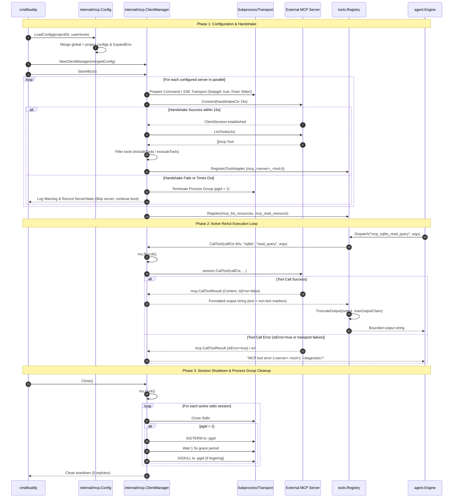

# Milestone 4: Model Context Protocol (MCP) Integration & Supervised Stdio Process Lifecycle

* **Author:** hoangndst
* **Date:** 2026-11-20
* **Status:** Approved
* **Target Path:** `docs/designs/04_model_context_protocol.md`
* **Artifact Path:** `docs/designs/04_model_context_protocol.md`

---

## 1. Overview & Problem Statement

### 1.1 The Problem

Autonomous software engineering agents must interact with diverse external systems—including relational databases, issue trackers, documentation repositories, and cloud platform APIs—to solve complex, real-world development tasks. Currently, `buddy-agent` supports only built-in native tools registered directly in Go code (`bash`, `read_file`, `write_file`, `edit_file`, and `save_memory`).

Attempting to scale tool capabilities by hardcoding third-party integrations natively into the core agent binary introduces critical architectural vulnerabilities:

1. **Monolithic Dependency Bloat**: Embedding database drivers, cloud SDKs, and third-party protocol parsers directly into `buddy-agent` dramatically inflates binary size, expands the security attack surface, and creates severe dependency maintenance overhead.
2. **Subprocess Orphan Leaks**: External tools executed over standard I/O (often launched via package runners like `npx` or `uvx`) spawn trees of descendant child processes (e.g., Python interpreters or Node.js runtimes). Standard process termination (`os.Process.Kill`) terminates only the parent launcher process, leaving orphaned background daemons that lock ports, consume host CPU/memory, and corrupt state.
3. **Context Window Token Exhaustion**: Third-party MCP servers routinely export 20 to 50+ tools. Unconditionally injecting every tool schema into the model's function declaration catalog on every turn consumes prohibitive prompt token budgets (often 10,000+ tokens per step), crowding out working context, accelerating token costs, and degrading reasoning fidelity.
4. **Synchronous Execution Stall & Fragility**: External tool servers that hang during startup handshakes, crash mid-turn, or experience network latency spikes risk locking the agent's synchronous ReAct (Reasoning + Acting) execution loop indefinitely unless protected by isolated process supervision and strict execution deadlines.

### 1.2 Solution Overview

Milestone 4 equips `buddy-agent` with an enterprise-grade, zero-CGO (pure Go static compilation without the C foreign function interface) **Model Context Protocol (MCP) Client Engine** implemented in `internal/mcp` using the official Go SDK (`github.com/modelcontextprotocol/go-sdk/mcp`).

The solution introduces six core architectural mechanisms:

1. **Universal Two-Tier Configuration Hierarchy**:
   - Merges global user configuration (`~/.buddy/mcp.json`) with repository-scoped configuration (`.buddy/mcp.json`), where workspace settings take precedence by server key.
   - Supports clean server deactivation via `disabled: true`.
   - Provides automated shell-style environment variable expansion (`os.ExpandEnv`) for credentials and paths.
   - Exposes comprehensive CLI management commands (`buddy mcp list`, `buddy mcp add`, `buddy mcp remove`).
2. **Supervised Process Group Lifecycle Management**:
   - Builds directly upon Milestone 2's process safety infrastructure ([`02_subprocess_safety.md`](02_subprocess_safety.md)) to spawn stdio child server processes within isolated OS process groups (`Setpgid: true` on POSIX systems, and Windows Job Objects with `JOB_OBJECT_LIMIT_KILL_ON_JOB_CLOSE`).
   - Executes cross-platform, escalated dual-phase teardown (`SIGTERM` $\to$ 1.5s grace period $\to$ `SIGKILL` directed strictly to process groups with `pgid > 1`) on session close or interrupt, guaranteeing zero orphaned server processes and eliminating host suicide risks.
   - Drains standard error asynchronously into bounded rolling buffers to prevent 64KB OS pipe buffer deadlocks.
3. **Dual Transport Support**:
   - **Local Subprocess Transport**: Built on `mcp.CommandTransport` with explicit termination duration alignment for local CLI tools and interpreters.
   - **Remote HTTP/SSE Transport**: Built on `mcp.StreamableClientTransport` for remote network services with configurable HTTP headers and Bearer token authentication via Server-Sent Events (SSE).
4. **Dynamic Tool Adapter & Sanitized Namespacing**:
   - Queries server tool catalogs dynamically at session startup via `session.ListTools(ctx)`.
   - Namespaces tools deterministically as `mcp_<server>_<tool>` with strict regex validation (`^[a-zA-Z0-9_-]{1,64}$`). For names exceeding 64 characters, clamps the prefix to 55 runes and appends a deterministic 8-character hex hash of the full name to guarantee uniqueness.
   - Adapts MCP `InputSchema` definitions into canonical OpenAI function parameter schemas via `tools.CanonicalizeParameters`.
   - Enforces memory-bounded central output truncation via `tools.Registry` on all tool return values.
5. **Token Headroom Protection, Tool Filtering & Resource Discovery**:
   - Allows users to specify optional `includeTools` (allowlists) and `excludeTools` (denylists) per server in `mcp.json`, where `excludeTools` takes precedence, restricting prompt token overhead to task-relevant capabilities.
   - Bridges MCP static and dynamic resources through complementary on-demand `mcp_list_resources` and `mcp_read_resource` tools, enabling autonomous URI discovery without upfront prompt inlining.
6. **Fault Isolation & Graceful Degradation**:
   - Implements a non-blocking 15-second initialization probe during startup. Servers that fail to launch or time out log descriptive warnings to `stderr`, record failure diagnostics in `ServerState`, and are skipped, allowing Buddy to boot successfully with healthy tools.
   - Wraps every tool execution in an isolated 60-second context deadline under reader-lock synchronization (`m.mu.RLock()`). Protocol errors and tool failures (`isError: true`) return structured diagnostic strings to model reasoning rather than triggering fatal engine panics.

### 1.3 In-Scope Goals

* Implement `internal/mcp` package using the official Go SDK (`github.com/modelcontextprotocol/go-sdk/mcp`).
* Implement two-tier configuration loader supporting `~/.buddy/mcp.json` (global) and `.buddy/mcp.json` (project) with `os.ExpandEnv` substitution and `disabled` flags.
* Implement CLI subcommands:
  - `buddy mcp list`: Displays active servers, transports, configuration source, health status, and discovered tool counts.
  - `buddy mcp add <name> [--global] -- <command> [args...]`: Persists local stdio server entry.
  - `buddy mcp add --url <url> [--header "Key: Value"]... [--global] <name>`: Persists remote SSE server entry with optional custom headers.
  - `buddy mcp remove <name> [--global]`: Removes server configuration.
* Implement supervised stdio transport (`mcp.CommandTransport`) reusing Milestone 2's cross-platform supervisor primitives (`internal/tools/subprocess`), enforcing POSIX `Setpgid: true` process group isolation, guarded `pgid > 1` teardown, Windows Job Objects, and bounded `stderr` draining.
* Implement remote SSE transport (`mcp.StreamableClientTransport`) with custom HTTP header injection.
* Implement dynamic tool discovery, collision-resistant `mcp_<server>_<tool>` sanitization, and schema adapter calling `tools.CanonicalizeParameters` registered into `internal/tools.Registry`.
* Implement per-server `includeTools` and `excludeTools` filtering with clear denylist precedence.
* Implement on-demand `mcp_list_resources` and `mcp_read_resource` bridge tools for querying MCP server resources.
* Implement thread-safe `ClientManager` accessors (`Tools()`, `GetSession()`, `ServerStates()`, and synchronized `CallTool`).
* Guarantee 100% pure Go static compilation with zero CGO across Linux (`amd64`, `arm64`), macOS (`amd64`, `arm64`), and Windows (`amd64`).

### 1.4 Out-of-Scope Non-Goals

* **Buddy as MCP Server**: Exposing Buddy's internal tools and execution state to external hosts (deferred to Milestone 7 Unix Socket Daemon & CLI Client, see [`docs/designs/SITEMAP.md`](SITEMAP.md)).
* **MCP Sampling**: Server-initiated LLM sampling requests (deferred to Milestone 6 Subagent Orchestration).
* **Interactive OAuth Handshakes**: Only static Bearer tokens and header injection are supported for remote HTTP/SSE servers in this milestone.
* **Mid-Session Dynamic Tool Mutation**: Mutating tool registries dynamically during an active turn loop (tools are discovered deterministically at session initialization to preserve prompt cache stability).

---

## 2. Technical Plan & Architecture

```mermaid
flowchart TD
    subgraph Config Layer
        GC["Global Config (~/.buddy/mcp.json)"] --> CM["Config Merger (internal/mcp/config.go)"]
        PC["Project Config (.buddy/mcp.json)"] --> CM
        ENV["Environment Expansion (os.ExpandEnv)"] --> CM
    end

    subgraph MCP Client Runtime (internal/mcp)
        CM --> MGR["ClientManager (internal/mcp/manager.go)"]
        MGR -->|Spawn Local| ST["Stdio Transport (CommandTransport + Setpgid)"]
        MGR -->|Connect Remote| RT["Remote SSE Transport (StreamableClientTransport)"]
        ST --> PS["Process Supervisor (Milestone 2 Dual-Phase Escalation)"]
        ST --> S1["Server Session 1"]
        RT --> S2["Server Session 2"]
        S1 --> DISC["Tool Discovery & Filtering (include/exclude)"]
        S2 --> DISC
        DISC --> ADAPT["ToolAdapter (internal/mcp/adapter.go)"]
    end

    subgraph Agent Runtime
        ADAPT --> REG["Tool Registry (internal/tools/registry.go)"]
        REG --> ENG["ReAct Engine (internal/agent/engine.go)"]
        MGR --> BRL["mcp_list_resources Bridge Tool"]
        MGR --> BRR["mcp_read_resource Bridge Tool"]
        BRL --> REG
        BRR --> REG
    end

    subgraph External Host & Network
        PS --> P1["POSIX Process Group (pgid > 1) / Win32 Job Object"]
        P1 --> PROC["External MCP Server Subprocesses"]
        RT --> NET["Remote MCP Endpoints (HTTP/SSE)"]
    end
```

### 2.1 Lifecycle Execution Flow

The MCP lifecycle executes across four distinct operational phases:



### 2.2 Configuration System (`internal/mcp/config.go`)

The configuration subsystem implements hierarchical resolution, JSON serialization, and dynamic expansion:

```go
package mcp

// Config represents the top-level configuration document structure.
type Config struct {
	MCPServers map[string]ServerConfig `json:"mcpServers"`
}

// ServerConfig specifies execution parameters for a single MCP server.
type ServerConfig struct {
	// Disabled allows disabling a global server in project config.
	Disabled bool `json:"disabled,omitempty"`

	// Stdio subprocess transport parameters
	Command string            `json:"command,omitempty"`
	Args    []string          `json:"args,omitempty"`
	Env     map[string]string `json:"env,omitempty"`

	// Remote HTTP/SSE transport parameters
	URL     string            `json:"url,omitempty"`
	Headers map[string]string `json:"headers,omitempty"`

	// Context token protection filters
	IncludeTools []string `json:"includeTools,omitempty"`
	ExcludeTools []string `json:"excludeTools,omitempty"`

	// Execution timeouts
	TimeoutSeconds int `json:"timeoutSeconds,omitempty"`
}
```

#### Configuration Precedence & Merging
1. **Global Base**: Discovered at `$HOME/.buddy/mcp.json`.
2. **Project Override**: Discovered at `$PROJECT_ROOT/.buddy/mcp.json`.
3. **Merging Invariant**: If a server key exists in both files, the project-level definition completely supersedes the global definition. Servers with unique keys are unioned into the active server map. If `Disabled: true` is set, the server is omitted from active startup.
4. **Tool Filtering Rule**: If both `IncludeTools` and `ExcludeTools` are defined, `ExcludeTools` takes precedence:
   $$\text{Allowed} = (Tool \in \text{IncludeTools}) \land (Tool \notin \text{ExcludeTools})$$
   If `IncludeTools` is empty, all server tools not in `ExcludeTools` are allowed.
5. **Environment Expansion**: All string values in `Args`, `Env`, `URL`, and `Headers` undergo `os.ExpandEnv` resolution before transport initialization. Inherited host environment variables may be filtered to avoid leaking sensitive agent API keys (`OPENAI_API_KEY`) to untrusted third-party subprocess packages unless explicitly forwarded.

### 2.3 Supervised Process Lifecycle & Stdio Transport (`internal/mcp/manager.go`)

Local stdio MCP servers are executed via the official SDK's `mcp.CommandTransport`. To guarantee process group isolation and prevent lingering zombie daemons:

1. **Process Group Attachment**:
   Reuses Milestone 2 process supervision primitives ([`02_subprocess_safety.md`](02_subprocess_safety.md)). On POSIX platforms (Linux, macOS), child commands configure `SysProcAttr`:
   ```go
   cmd.SysProcAttr = &syscall.SysProcAttr{Setpgid: true}
   ```
   On Windows, processes are bound to an anonymous Windows Job Object configured with `JOB_OBJECT_LIMIT_KILL_ON_JOB_CLOSE`.
2. **Asynchronous Stderr Draining & Diagnostic Capture**:
   To prevent unconsumed standard error pipes from filling the OS 64KB pipe buffer and deadlocking subprocesses, a 4KB bounded rolling buffer is attached to `cmd.Stderr`. On startup failure or abnormal exit, buffered stderr lines are captured directly into `ServerState.LastError`.
3. **15-Second Startup Handshake Watchdog**:
   Server connections are wrapped with an isolated deadline:
   ```go
   handshakeCtx, cancel := context.WithTimeout(ctx, 15*time.Second)
   defer cancel()
   session, err := client.Connect(handshakeCtx, transport, nil)
   ```
   If a binary is missing from `$PATH` or deadlocks during initialization, the probe expires, releases the process group via `KillProcessGroup`, logs an informative warning, and marks the server status as `StatusFailed` with the captured `LastError`. Buddy's main startup routine continues unhindered.
4. **Dual-Phase Signal Escalation Teardown**:
   When `ClientManager.Close()` is invoked:
   - Stdin pipes are closed immediately.
   - For POSIX stdio processes, `pgid` is checked: **only if `pgid > 1`** is `syscall.Kill(-pgid, syscall.SIGTERM)` dispatched, preventing host suicide if `pgid <= 1`.
   - A 1.5-second timer monitors process termination.
   - If processes remain alive after 1.5 seconds, `syscall.Kill(-pgid, syscall.SIGKILL)` is sent unconditionally, guaranteeing zero orphaned processes.
   - On Windows, closing the Job Object handle automatically terminates all processes in the job tree.
   - `mcp.CommandTransport.TerminateDuration` is configured to 0 or 1.5s to ensure SDK defaults do not introduce redundant delays.

### 2.4 Remote Streamable HTTP/SSE Transport

Remote MCP endpoints are connected via `mcp.StreamableClientTransport`:
- Configured with custom `http.RoundTripper` injecting defined headers (e.g., `Authorization: Bearer <token>`).
- Transport reconnections and SSE streaming are managed through the official Go SDK.
- Network connection drops trigger structured diagnostic messages without crashing the harness.

### 2.5 Dynamic Tool Adapter & Schema Normalization (`internal/mcp/adapter.go`)

MCP tools bridge cleanly into Buddy's `tools.Tool` interface without introducing circular dependencies or violating OpenAI parameter schemas.

#### Tool Struct Definition
```go
package mcp

import (
	"context"
	"crypto/sha256"
	"encoding/hex"
	"encoding/json"
	"fmt"
	"strings"
	"time"

	"github.com/hoangndst/buddy-agent/internal/tools"
	"github.com/modelcontextprotocol/go-sdk/mcp"
)

// ToolAdapter wraps an external MCP tool definition to satisfy tools.Tool.
type ToolAdapter struct {
	serverName string
	tool       mcp.Tool
	manager    *ClientManager
	timeout    time.Duration
}

func (a *ToolAdapter) Name() string {
	return SanitizeToolName(a.serverName, a.tool.Name)
}

func (a *ToolAdapter) Description() string {
	return a.tool.Description
}

func (a *ToolAdapter) Parameters() any {
	return tools.CanonicalizeParameters(a.tool.InputSchema)
}

func (a *ToolAdapter) Execute(ctx context.Context, args json.RawMessage) (string, error) {
	callCtx, cancel := context.WithTimeout(ctx, a.timeout)
	defer cancel()

	var parsedArgs map[string]any
	if len(args) > 0 {
		if err := json.Unmarshal(args, &parsedArgs); err != nil {
			return fmt.Sprintf("MCP tool parameter error (%s.%s): invalid JSON arguments: %v", a.serverName, a.tool.Name, err), nil
		}
	}

	res, err := a.manager.CallTool(callCtx, a.serverName, a.tool.Name, parsedArgs)
	if err != nil {
		return fmt.Sprintf("MCP tool error (%s.%s): %v", a.serverName, a.tool.Name, err), nil
	}

	var sb strings.Builder
	for _, content := range res.Content {
		switch c := content.(type) {
		case *mcp.TextContent:
			sb.WriteString(c.Text)
		case *mcp.ImageContent:
			sb.WriteString(fmt.Sprintf("[Image: mimeType=%s, size=%d bytes]\n", c.MIMEType, len(c.Data)))
		case *mcp.EmbeddedResource:
			sb.WriteString(fmt.Sprintf("[Embedded Resource: uri=%s]\n", c.Resource.URI))
		}
	}

	if res.IsError {
		return fmt.Sprintf("MCP tool returned error (%s.%s): %s", a.serverName, a.tool.Name, sb.String()), nil
	}

	return sb.String(), nil
}
```

#### Tool Namespacing & Sanitization
OpenAI tool calling enforces regex constraint `^[a-zA-Z0-9_-]{1,64}$`.
`SanitizeToolName(server, tool)` transforms names deterministically:
1. Replaces any rune in `server` and `tool` not matching `[a-zA-Z0-9_-]` with an underscore (`_`).
2. Constructs `base := fmt.Sprintf("mcp_%s_%s", serverClean, toolClean)`.
3. If `len(base) <= 64`, returns `base`.
4. If `len(base) > 64`, computes `hash := sha256.Sum256([]byte(base))`, truncates `base` to 55 runes, and appends `_` + hex string of the first 4 bytes (`hash[:4]`, 8 hex chars), guaranteeing uniqueness within 64 runes.

### 2.6 On-Demand Resource Discovery & Reader Bridge (`internal/mcp/resource.go`)

Rather than polluting prompts by pre-fetching static resources from external servers, Buddy registers two complementary bridge tools in `tools.Registry`:

#### 1. Resource Lister Tool (`mcp_list_resources`)
* **Name**: `mcp_list_resources`
* **Description**: `"List available resource URIs and descriptions exposed by an external Model Context Protocol (MCP) server."`
* **Parameters**:
  ```json
  {
    "type": "object",
    "properties": {
      "server": {
        "type": "string",
        "description": "The name of the configured MCP server."
      }
    },
    "required": ["server"]
  }
  ```
* **Execution**: Dispatches `session.ListResources(ctx, nil)`, extracts URI templates, names, and descriptions, returning a structured summary to model context for dynamic discovery.

#### 2. Resource Reader Tool (`mcp_read_resource`)
* **Name**: `mcp_read_resource`
* **Description**: `"Read content from an external Model Context Protocol (MCP) server resource URI."`
* **Parameters**:
  ```json
  {
    "type": "object",
    "properties": {
      "server": {
        "type": "string",
        "description": "The name of the configured MCP server."
      },
      "uri": {
        "type": "string",
        "description": "The resource URI identifier exposed by the server (e.g. 'postgres://schema/public')."
      }
    },
    "required": ["server", "uri"]
  }
  ```
* **Execution**: Dispatches `session.ReadResource(ctx, &mcp.ReadResourceParams{Uri: uri})`. Extracts text content directly. For binary/blob contents (`*mcp.BlobResourceContents`), formats descriptive metadata (e.g., `[Binary Resource: uri=%s, mimeType=%s, size=%d bytes]`) to avoid corrupting prompt string context with raw bytes.

### 2.7 Concurrency & Thread-Safety Model

1. **Manager Synchronization**: `ClientManager` protects internal session and process maps using `sync.RWMutex`.
   - Tool execution (`CallTool`) and session querying (`GetSession`) acquire `m.mu.RLock()`.
   - Server lifecycle mutations (`StartAll`, restarting, closing) acquire `m.mu.Lock()`.
2. **Public ClientManager API**:
   ```go
   type ClientManager struct {
       mu       sync.RWMutex
       sessions map[string]*mcp.ClientSession
       states   map[string]ServerState
       cmds     map[string]*exec.Cmd
       tools    []tools.Tool
   }

   func (m *ClientManager) Tools() []tools.Tool
   func (m *ClientManager) GetSession(serverName string) (*mcp.ClientSession, bool)
   func (m *ClientManager) ServerStates() map[string]ServerState
   func (m *ClientManager) CallTool(ctx context.Context, serverName, toolName string, args map[string]any) (*mcp.CallToolResult, error)
   func (m *ClientManager) Close() error
   ```
3. **Parallel Tool Calls**: The OpenAI SDK supports parallel tool invocations in a single turn. `ToolAdapter.Execute` is stateless and invokes `manager.CallTool` under read locks, allowing concurrent tool dispatches across multiple MCP servers without serialization bottlenecks.

---

## 3. Critical User Journeys (CUJs)

### CUJ 1: Developer Adds Local Database MCP Server via CLI
* **Given**: A developer wants Buddy to inspect an SQLite database during debugging.
* **When**: The user runs `buddy mcp add sqlite -- uvx mcp-server-sqlite --db-path ./test.db`.
* **Then**: Buddy appends the server entry to `.buddy/mcp.json`. On next startup, Buddy launches the subprocess within an isolated process group, completes initialization within 15 seconds, discovers `read_query`, namespaces it as `mcp_sqlite_read_query`, and registers it into `internal/tools.Registry`.

### CUJ 2: Server Fails During Boot Without Crashing Buddy
* **Given**: A configured MCP server binary is missing from `$PATH` (e.g. `uvx` not installed).
* **When**: Buddy starts up in REPL or CLI task mode.
* **Then**: The 15-second handshake/launch probe detects the failure, logs a clear warning (`Warning: MCP server "sqlite" failed to start: uvx executable not found in $PATH; skipping`), records `StatusFailed` with the captured error in `ServerState.LastError`, and continues booting Buddy with all native tools and healthy MCP servers intact.

### CUJ 3: Safe Teardown of Stdio Child Process Groups
* **Given**: An agent session with 3 running stdio MCP servers terminates via `Ctrl+C` or task completion.
* **When**: The root context is cancelled.
* **Then**: Buddy's MCP manager initiates session shutdown, closes stdin pipes, verifies `pgid > 1`, sends `SIGTERM` to the process groups, waits up to 1.5s, and broadcasts `SIGKILL` to any lingering processes. Zero orphaned server processes remain alive, and the host process group is never signalled.

### CUJ 4: Dynamic Discovery and On-Demand Resource Reading
* **Given**: A remote MCP server exposes documentation or database schema definitions as MCP resources.
* **When**: The agent is asked to analyze database schema but does not know what resources exist.
* **Then**: The model invokes `mcp_list_resources(server: "postgres")`, discovering `postgres://schema/public`. The model then invokes `mcp_read_resource(server: "postgres", uri: "postgres://schema/public")`. Buddy dispatches the read call to the active session and returns the resource payload without having polluted prompt context in prior steps.

---

## 4. Alternatives Considered

### 4.1 Custom Hand-Rolled JSON-RPC 2.0 Subprocess Stdio Driver
* **Description**: Implement a lightweight in-house JSON-RPC 2.0 parser and framing protocol over `os.Stdin` and `os.Stdout` without external third-party dependencies.
* **Rejected by author**: The Model Context Protocol specification is rapidly evolving and encompasses nuanced lifecycle handshakes, schema negotiations, resource subscriptions, and SSE reconnection semantics. Hand-rolling a custom protocol driver duplicates substantial engineering surface and creates ongoing maintenance debt. Adopting the official `github.com/modelcontextprotocol/go-sdk` guarantees standard conformance and upstream protocol updates with zero CGO dependencies.

### 4.2 Flat Tool Namespaces Without Prefixing
* **Description**: Pass external MCP tool names directly into `tools.Registry` using their bare names (e.g. `query`, `read`, `execute`).
* **Rejected by author**: Exposing raw tool names introduces fatal name collision vectors:
  1. Collisions between independent MCP servers (e.g., both an SQLite server and a PostgreSQL server defining a tool named `query`).
  2. Collisions with Buddy's native built-in tools (e.g., an external server declaring `bash` or `read_file`).
  Prefixing tool names deterministically as `mcp_<server>_<tool>` with hash fallback guarantees collision-free registration, deterministic tool routing, and clear operational provenance during trajectory auditing.

### 4.3 Pre-Fetching and Inlining MCP Resources into System Prompts
* **Description**: Query all MCP resources on session startup via `session.ListResources` and inject their full textual bodies into the model's system prompt or initial user turn.
* **Rejected by author**: External servers often export extensive database schemas, API references, or log histories that span tens of thousands of tokens. Inlining resources upfront prematurely consumes prompt context before the agent has determined whether those resources are relevant. Exposing the complementary `mcp_list_resources` and `mcp_read_resource` bridge tools empowers the model to discover and pull context dynamically only when needed, preserving critical prompt headroom.

### 4.4 Dynamic Hot-Reloading of Tool Catalogs Mid-Turn
* **Description**: Allow MCP servers to asynchronously push tool additions or deletions during active multi-turn reasoning loops.
* **Rejected by author**: Mutating the active tool catalog midway through an agent task introduces severe reasoning instabilities:
  1. Modifying tool declarations invalidates the prompt prefix hash, destroying prompt cache hit rates across OpenAI and Anthropic providers.
  2. An in-flight tool call can fail if its definition was removed between turn generation and tool dispatch.
  Registering tools deterministically at session boot ensures an immutable, stable contract throughout the agent's execution.

### 4.5 Crashing Agent Execution on Initial Server Failure (Fail-Fast Boot)
* **Description**: Abort Buddy startup immediately if any configured MCP server fails to launch, times out during handshake, or returns a connection error.
* **Rejected by author**: In real-world developer workflows, external dependencies are frequently transient or optional (e.g. a remote test endpoint is down, or a secondary CLI tool is not installed on a teammate's machine). Crashing the entire agent loop because an auxiliary MCP server failed creates severe availability fragility. Buddy must isolate failures to the affected server, log descriptive warnings, and proceed with all native tools and healthy servers intact.

---

## 5. Detailed Implementation Plan

The implementation plan is structured into four sequential phases, strictly enumerating every affected file and its rationale without generating implementation code.


### 5.1 Enumerate Files Touched & Created

| File Path | Action | Rationale |
| :--- | :---: | :--- |
| `go.mod` / `go.sum` | **Modify** | Add `github.com/modelcontextprotocol/go-sdk` dependency. |
| `internal/mcp/types.go` | **Create** | Declares core domain types (`ServerStatus`, `TransportType`, `ServerState`, error sentinels) decoupled from runtime engines. |
| `internal/mcp/config.go` | **Create** | Implements `Config` and `ServerConfig` JSON structs with `Disabled` support, two-tier merging (`~/.buddy/mcp.json` and `.buddy/mcp.json`), and `os.ExpandEnv` substitution. |
| `internal/mcp/config_test.go` | **Create** | Unit tests verifying configuration loading, merging precedence, environment expansion, and malformed JSON recovery. |
| `internal/mcp/transport.go` | **Create** | Shared transport constructors bridging `ServerConfig` into `mcp.CommandTransport` and `mcp.StreamableClientTransport`. |
| `internal/mcp/supervisor.go` | **Create** | Cross-platform process group supervisor interface leveraging Milestone 2 primitives (`internal/tools/subprocess`), bounded stderr buffer draining, and `KillProcessGroup(cmd *exec.Cmd, graceful bool) error` guarded by `pgid > 1`. |
| `internal/mcp/manager.go` | **Create** | Central `ClientManager` coordinating parallel startup handshakes (15s watchdog), session registry, thread-safe public accessors (`Tools()`, `GetSession()`, `ServerStates()`, `CallTool()`), and graceful dual-phase teardown. |
| `internal/mcp/manager_test.go` | **Create** | Integration tests with mock stdio servers testing handshake success, handshake timeout abort, stderr capture, and process group termination. |
| `internal/mcp/adapter.go` | **Create** | `ToolAdapter` implementing `tools.Tool`, collision-resistant regex-sanitized namespacing (`mcp_<server>_<tool>` with 8-char hex hash fallback), schema canonicalization (`tools.CanonicalizeParameters`), and non-text marker formatting. |
| `internal/mcp/adapter_test.go` | **Create** | Unit tests for tool name sanitization, collision hash fallback, schema mapping, successful execution, `isError` formatting, and timeout recovery. |
| `internal/mcp/resource.go` | **Create** | Implements on-demand `mcp_list_resources` and `mcp_read_resource` bridge tools for querying server resource URIs and metadata. |
| `internal/mcp/resource_test.go` | **Create** | Unit tests for resource lister and reader execution, invalid URI handling, binary blob metadata formatting, and server not found recovery. |
| `cmd/buddy/mcp.go` | **Create** | Implements CLI command handlers for `buddy mcp list`, `buddy mcp add`, and `buddy mcp remove` with `flag.NewFlagSet`, `--global`, and `--header` support. |
| `cmd/buddy/main.go` | **Modify** | Dispatches `buddy mcp` CLI subcommands in early routing, boots `ClientManager` during agent startup, registers discovered tools and resource bridge tools into `tools.Registry`. |
| `docs/designs/SITEMAP.md` | **Modify** | Update Milestone 4 status from In Review to Approved. |

---

### 5.2 Phased Execution Steps

#### Phase 1: Configuration Management & CLI Interface
1. Add `github.com/modelcontextprotocol/go-sdk` to `go.mod`.
2. Implement `internal/mcp/types.go` declaring:
   - `type ServerStatus string` (`StatusRunning`, `StatusFailed`, `StatusStopped`).
   - `type TransportType string` (`TransportStdio`, `TransportSSE`).
   - `type ServerState struct`: Name, Transport, Source (`global`/`project`), Status, DiscoveredTools count, LastError.
   - Sentinel errors: `ErrServerNotFound`, `ErrServerUnavailable`, `ErrHandshakeTimeout`, `ErrToolExecutionTimeout`.
3. Implement `internal/mcp/config.go`:
   - `LoadConfig(projectDir, userHome string) (*Config, error)`:
     - Reads `$HOME/.buddy/mcp.json` if present.
     - Reads `$PROJECT_ROOT/.buddy/mcp.json` if present.
     - Performs key-wise merge where project-level server definitions override global servers. Omits servers with `Disabled: true`.
     - Applies recursive `os.ExpandEnv` across command strings, argument slices, environment maps, URLs, and headers.
   - `SaveProjectConfig(projectDir string, cfg *Config) error`: Writes serialized JSON with 2-space indentation.
   - `SaveGlobalConfig(userHome string, cfg *Config) error`: Writes global config.
4. Implement `cmd/buddy/mcp.go` and wire early CLI routing in `cmd/buddy/main.go`:
   - In `cmd/buddy/main.go`, check `if len(os.Args) > 1 && os.Args[1] == "mcp"` prior to task execution and delegate to `mcp.RunCLI(ctx, os.Args[2:])`.
   - `buddy mcp list`: Displays formatted CLI table of active servers, transport types, configuration provenance, health status, and tool counts.
   - `buddy mcp add <name> [--global] -- <command> [args...]`: Appends a stdio server entry to `.buddy/mcp.json` (or `~/.buddy/mcp.json` if `--global` is specified).
   - `buddy mcp add --url <url> [--header "Key: Value"]... [--global] <name>`: Appends a remote HTTP/SSE server entry with optional custom headers.
   - `buddy mcp remove <name> [--global]`: Removes server from target config.
5. Unit tests in `internal/mcp/config_test.go` covering two-tier precedence, `disabled` flag behavior, environment expansion, and write-back.

#### Phase 2: Transports & Process Group Lifecycle Supervisor
1. Implement `internal/mcp/transport.go` and `internal/mcp/supervisor.go`:
   - Construct `exec.Cmd` merging `os.Environ()` with configured server `Env`.
   - Attach a 4KB bounded rolling buffer to `cmd.Stderr` to prevent unconsumed pipe deadlocks and capture error logs.
   - Integrate with Milestone 2 process supervision primitives (`internal/tools/subprocess`):
     - On POSIX, set `cmd.SysProcAttr = &syscall.SysProcAttr{Setpgid: true}`.
     - On Windows, attach process to an anonymous Job Object with `JOB_OBJECT_LIMIT_KILL_ON_JOB_CLOSE`.
   - Implement platform-neutral `KillProcessGroup(cmd *exec.Cmd, graceful bool) error`:
     - On POSIX: strictly guard with `if pgid > 1`. If `graceful=true`, sends `syscall.SIGTERM` to `-pgid`; if `graceful=false`, sends `syscall.SIGKILL` to `-pgid`.
     - On Windows: terminates via Job Object.
   - Set `mcp.CommandTransport.TerminateDuration` to 0 or 1.5s to align with Buddy's dual-phase escalation.
2. Implement `internal/mcp/manager.go`:
   - `type ClientManager struct` with `mu sync.RWMutex`, `sessions map[string]*mcp.ClientSession`, `states map[string]ServerState`, `cmds map[string]*exec.Cmd`, and `tools []tools.Tool`.
   - Provide thread-safe public accessors:
     - `func (m *ClientManager) Tools() []tools.Tool`
     - `func (m *ClientManager) GetSession(serverName string) (*mcp.ClientSession, bool)`
     - `func (m *ClientManager) ServerStates() map[string]ServerState`
     - `func (m *ClientManager) CallTool(ctx context.Context, serverName, toolName string, args map[string]any) (*mcp.CallToolResult, error)`
   - `StartAll(ctx context.Context) map[string]error`:
     - Spawns goroutines to initialize each configured server concurrently with mutex-protected state collection.
     - Wraps connection in `context.WithTimeout(ctx, 15*time.Second)`.
     - Stdio servers instantiate `mcp.NewCommandTransport(cmd)`.
     - Remote SSE servers instantiate `mcp.NewStreamableClientTransport(url, httpClient)`.
     - Calls `client.Connect(handshakeCtx, transport, nil)`.
     - If connection fails or times out, terminates process group via `KillProcessGroup`, records `StatusFailed` with captured stderr in `ServerState.LastError`, logs a descriptive warning to `stderr`, and returns without failing `StartAll`.
   - `Close()`:
     - Acquires write lock `m.mu.Lock()`.
     - Closes all active `ClientSession` instances.
     - For each stdio process, closes stdin, issues `KillProcessGroup(cmd, true)` (`SIGTERM` to `-pgid` if `pgid > 1`), waits up to 1.5s grace period, and issues `KillProcessGroup(cmd, false)` (`SIGKILL` to `-pgid`) if still alive.
3. Integration tests in `internal/mcp/manager_test.go` verifying handshake timeout termination, stderr capture, and zero orphan process leaks.

#### Phase 3: Dynamic Tool Adapter & Registry Integration
1. Implement `internal/mcp/adapter.go`:
   - `SanitizeToolName(server, tool string) string`:
     - Combines `"mcp_" + server + "_" + tool`.
     - Replaces any rune not matching `[a-zA-Z0-9_-]` with an underscore (`_`).
     - If $> 64$ runes, truncates prefix to 55 runes and appends `_` + 8-character hex hash of the full name.
   - `ToolAdapter` implementing `tools.Tool`:
     - `Name()`: Returns sanitized name.
     - `Description()`: Returns `mcp.Tool.Description`.
     - `Parameters()`: Returns `tools.CanonicalizeParameters(a.tool.InputSchema)`.
     - `Execute(ctx, args)`:
       - Enforces per-call timeout (`60s` default or configured `TimeoutSeconds`).
       - Validates `json.Unmarshal(args, &parsedArgs)`, returning syntax error to model if invalid.
       - Dispatches via `a.manager.CallTool(callCtx, a.serverName, a.tool.Name, parsedArgs)`.
       - Formats `*mcp.TextContent`, `*mcp.ImageContent`, and `*mcp.EmbeddedResource` into output string.
       - If `res.IsError == true`, formats return string as `"MCP tool returned error (<server>.<tool>): <text>"`.
       - If call returns transport error, formats as `"MCP tool error (<server>.<tool>): <err>"`.
2. In `ClientManager.StartAll`:
   - For each successfully connected server, calls `session.ListTools(ctx)`.
   - Filters tools against `serverCfg.IncludeTools` and `serverCfg.ExcludeTools` (with `ExcludeTools` taking precedence).
   - Instantiates `ToolAdapter` for each allowed tool and stores in `m.tools`.
3. Unit tests in `internal/mcp/adapter_test.go` verifying sanitization, collision hash fallback, parameter canonicalization, and error formatting.

#### Phase 4: Resource Bridge, Wire-up & End-to-End Verification
1. Implement `internal/mcp/resource.go`:
   - `NewResourceListerTool(manager *ClientManager) tools.Tool`:
     - Declares tool `mcp_list_resources` taking `{"server": "string"}`.
     - Looks up target server session from `manager.GetSession(server)`.
     - Calls `session.ListResources(ctx, nil)`.
     - Returns formatted list of resource URIs, names, and descriptions.
   - `NewResourceReaderTool(manager *ClientManager) tools.Tool`:
     - Declares tool `mcp_read_resource` taking `{"server": "string", "uri": "string"}`.
     - Looks up target server session from `manager.GetSession(server)`.
     - Calls `session.ReadResource(ctx, &mcp.ReadResourceParams{Uri: uri})`.
     - Extracts text payload or formats binary blob metadata marker, and returns.
2. Wire into `cmd/buddy/main.go`:
   - Initialize `mcp.LoadConfig(workDir, userHome)`.
   - Instantiate `mcp.NewClientManager(cfg)`.
   - Call `manager.StartAll(ctx)`.
   - Register discovered tools via `for _, t := range manager.Tools() { registry.Register(t) }`.
   - Register `mcp_list_resources` and `mcp_read_resource` into `tools.Registry`.
   - Add deferred `manager.Close()` to ensure graceful process group teardown on exit.
3. Verification Suite:
   - Full race detector pass: `go test -count=1 -race ./...`.
   - Linter pass: `golangci-lint run ./...`.
   - Cross-platform static compilation matrix:
     - `CGO_ENABLED=0 GOOS=linux GOARCH=amd64 go build -o /dev/null ./cmd/buddy`
     - `CGO_ENABLED=0 GOOS=linux GOARCH=arm64 go build -o /dev/null ./cmd/buddy`
     - `CGO_ENABLED=0 GOOS=darwin GOARCH=amd64 go build -o /dev/null ./cmd/buddy`
     - `CGO_ENABLED=0 GOOS=darwin GOARCH=arm64 go build -o /dev/null ./cmd/buddy`
     - `CGO_ENABLED=0 GOOS=windows GOARCH=amd64 go build -o /dev/null ./cmd/buddy`
