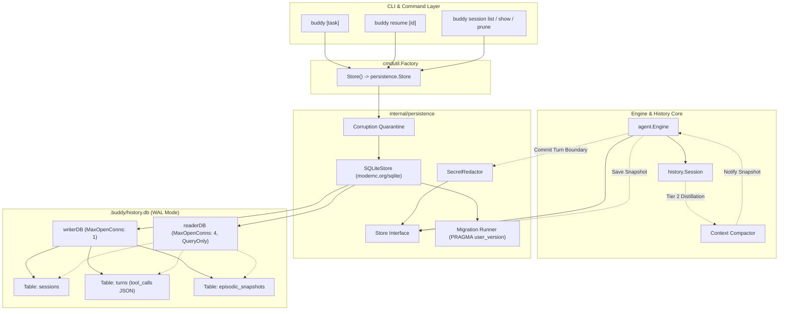
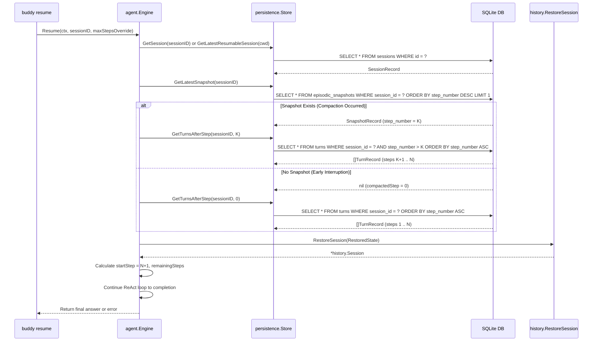

# Milestone 6: Pure Go SQLite Episodic State Persistence and Crash Recovery

* **Author:** hoangndst
* **Date:** 2026-11-20
* **Status:** Approved
* **Target Path:** `docs/designs/06_sqlite_state_persistence.md`
* **Artifact Path:** `docs/designs/06_sqlite_state_persistence.md`

---

## 1. The Problem

During previous milestones, `buddy-agent` developed an in-memory context architecture (Milestone 3: Three-Partition memory compaction and episodic state tracking; Milestone 4: Model Context Protocol; Milestone 5: Universal model protocols and human-centric REPL UX). However, all session state, turn blocks, tool execution telemetry, token metrics, and reasoning outputs are held strictly in volatile process memory.

This architecture creates four operational limitations:

1. **Total Trajectory Amnesia on Exit or Crash**:
   When a task completes, the user exits the REPL, or the process terminates abnormally (terminal disconnection, OS `SIGINT`/`SIGTERM`, unhandled error, network timeout, step budget exhaustion, or context exhaustion), all trajectory data vanishes. The user cannot audit which files were modified, what commands failed, or what reasoning path the agent pursued.

2. **Inability to Resume Interrupted Tasks**:
   Long-running multi-step engineering tasks (such as refactoring multiple files or running comprehensive test suites) interrupted at step 15 cannot be resumed. The developer must re-run the entire prompt from step 1, discarding completed progress, wasting expensive API tokens, and risking conflicting file edits.

3. **Missing Forensic Telemetry and Historical Querying**:
   There is no persistent ledger to answer basic operational questions: How many tokens did recent sessions consume? What tool exit codes occurred across runs? Which sessions succeeded or failed?

4. **Blocker for Future Milestones**:
   Downstream milestones strictly require durable storage:
   - Milestone 7 (Subagent Orchestration): requires querying parent and child agent trajectories.
   - Milestone 8 (Unix Socket Daemon): requires background daemon persistence across client disconnections.
   - Milestone 9 (Bubbletea Interactive TUI): requires loading historical sessions and expanding past turn details.

Milestone 6 resolves these limitations by introducing an embedded, pure-Go SQLite episodic persistence engine and crash-recovery audit ledger with zero CGO dependencies.

---

## 2. Overview

Milestone 6 integrates an embedded, transaction-safe SQLite database into `buddy-agent`, establishing an immutable trajectory ledger and state reconstitution engine:

- **Zero-CGO Pure Go SQLite Engine**:
  - Employs `modernc.org/sqlite v1.36.0` (pure Go transpiled from SQLite C source, compatible with Go 1.21+).
  - Maintains strict `CGO_ENABLED=0` static single-binary compilation across all five target architectures (`linux/amd64`, `linux/arm64`, `darwin/amd64`, `darwin/arm64`, `windows/amd64`).
  - Database file stored at `.buddy/history.db` within the workspace root, with automatic fallback to user cache `~/.buddy/history.db` for read-only workspaces. Configurable via `BUDDY_DB_PATH` or `--db-path`.

- **Dual Connection Pool Concurrency Model**:
  - Separates write and read database handles to prevent deadlocks and harness SQLite Write-Ahead Logging (WAL):
    - `writerDB *sql.DB`: strictly constrained to `SetMaxOpenConns(1)` and `SetMaxIdleConns(1)` for serializing all write transactions (`BEGIN IMMEDIATE`).
    - `readerDB *sql.DB`: configured with `SetMaxOpenConns(4)` and `_pragma=query_only(ON)` for non-blocking concurrent reads (such as CLI inspection commands or background telemetry).
  - Configures SQLite PRAGMAs directly in the DSN:
    - `_pragma=journal_mode(WAL)`: Write-Ahead Logging for non-blocking concurrent reads.
    - `_pragma=synchronous(NORMAL)`: high write throughput safe in WAL mode.
    - `_pragma=busy_timeout(2500)`: 2.5-second graceful busy wait on file locks.
    - `_pragma=foreign_keys(ON)`: relational integrity enforcement.
    - `_pragma=auto_vacuum(INCREMENTAL)`: enabled at database initialization before table creation.
    - `_txlock=immediate`: automatically upgrades transactions to `BEGIN IMMEDIATE`.

- **Lean Relational Schema with Domain-Aggregate Atomicity**:
  - Drops speculative generic event logging tables in favor of structured domain aggregates.
  - **`sessions` table**: Tracks session lifecycle (`running`, `completed`, `failed`, `interrupted`), workspace directory, task prompt, model name, max step budget, total completed steps, cumulative token metrics, and execution duration.
  - **`turns` table**: Represents an indivisible atomic execution step (matching Milestone 3 `TurnBlock`) with composite primary key `(session_id, step_number)`. Contains assistant text, reasoning content, token usage, duration, and an indivisible `tool_calls JSON` column capturing all tool invocations and results for that turn.
  - **`episodic_snapshots` table**: An append-only distillation ledger capturing point-in-time Three-Partition episodic state (`distilled_narrative` and serialized `state_tracker`) generated during Tier 2 context compactions.

- **Crash Recovery & Sliced Session Resumption**:
  - Traps interruption signals (`SIGINT`, `SIGTERM`) directly inside `Engine`'s step loop. Updates session status to `interrupted` using `context.WithoutCancel(ctx)` with a 5-second timeout (exceeding the 2.5-second SQLite busy timeout), preventing premature cancellation during shutdown writes.
  - Derives `startStep` strictly from the latest committed turn (`COALESCE(MAX(step_number), 0) + 1`), ensuring interrupted in-flight steps are cleanly re-executed rather than skipped.
  - Symmetrical `Engine.Resume(ctx, sessionID)` method:
    1. Loads the session record and latest episodic snapshot (if any) from `episodic_snapshots`.
    2. Sequentially loads only uncompacted active turns where `step_number > snapshot.step_number` into Partition 3.
    3. Re-hydrates `history.Session` via `history.RestoreSession`, preserving the root user task block in Partition 3 if no compaction has occurred.
    4. Continues the ReAct execution loop from step $N+1$ with remaining step budgets.

- **Security, Redaction, and Self-Healing**:
  - File permissions enforced: `.buddy/` created with `0700`, `history.db` created with `0600`.
  - Auto-creates `.buddy/.gitignore` containing `*` to eliminate risk of accidental Git check-in.
  - Regex-based `SecretRedactor` scrubs Bearer tokens, GitHub PATs, OpenAI keys, AWS credentials, private keys, and URI credentials before database persistence.
  - UTF-8 safe boundary truncation on 64KB tool output storage limits.
  - Automated corruption detection (`PRAGMA quick_check(1)`) with quarantine to `.buddy/history.db.corrupt.<timestamp>` to prevent CLI lockouts.

- **Human-Centric CLI Surface**:
  - `buddy session list` (`buddy sessions`): Lists historical sessions with short IDs, task snippets, status indicators, step counts, duration, and token usage.
  - `buddy session show <id>`: Renders full turn-by-turn trajectory, reasoning blocks, tool arguments, exit codes, and output previews with support for Git-style short ID prefixes.
  - `buddy resume [id]`: Resumes the specified session or defaults to the most recent `interrupted` or `failed` session in the active workspace. Supports `--max-steps` to extend step headroom.
  - `buddy session prune`: Prunes sessions older than configured retention (default: 30 days) and runs incremental vacuum.

---

## 3. Goals & Non-Goals

### In-Scope Goals
- **Zero-CGO Pure Go Invariant**: Compile statically with `CGO_ENABLED=0` across Linux, macOS, and Windows.
- **Dual-Pool Concurrency Safety**: Dedicated single-connection writer pool and multi-connection reader pool to eliminate SQLite locking failures and deadlocks.
- **Atomic Turn Persistence**: Commit turn metadata, reasoning content, and tool calls in a single atomic transaction at step completion boundaries.
- **Engine-Level Graceful Shutdown**: Persist `status = 'interrupted'` upon OS signals directly inside `Engine` using `context.WithoutCancel`.
- **Bounded Storage Footprint**: Truncate tool execution outputs to a hard ceiling of 64KB at rune boundaries before writing to SQLite.
- **Secret Redaction**: Scrub sensitive credentials before persisting to SQLite.
- **Episodic Step-Boundary Slicing**: Reconstitute sessions using the latest episodic snapshot and trailing uncompacted turns.
- **Self-Healing Corruption Quarantine**: Quarantine corrupt database files automatically to keep the CLI operational.
- **Workspace Isolation**: Scope session queries to the current working directory, preventing cross-contamination in shared database fallbacks.
- **CLI Commands**: Implement `buddy session list`, `buddy session show <id>`, `buddy session prune`, and `buddy resume [id]`.
- **In-Memory Testing**: Support unique named in-memory databases (`file:memdb_...?mode=memory&cache=shared`) for deterministic, fast unit and integration tests.

### Non-Goals
- Remote networked database backends (PostgreSQL, MySQL). SQLite is strictly the local embedded engine.
- Vector search / embeddings across historical sessions (deferred to future memory enhancement milestones).
- Multi-agent parent-child session orchestration (reserved for Milestone 7).
- Micro-event streaming persistence. Intra-turn streaming events remain in-memory for live terminal rendering.

---

## 4. System Architecture



### 4.1 Component Responsibilities

1. **`internal/persistence`**:
   - Manages SQLite connection lifecycle using dual connection pools (`writerDB` and `readerDB`).
   - Implements schema migrations using `PRAGMA user_version`.
   - Exposes clean, thread-safe Go interfaces for session CRUD, turn commits, and snapshot retrieval.
   - Enforces 64KB UTF-8 tool output limits and secret redaction.
   - Handles corruption detection and auto-quarantine.

2. **`internal/history`**:
   - Adds `RestoredState` and `RestoreSession(state RestoredState, opts ...Option) (*Session, error)` to reconstitute memory partitions without resetting to step 0.
   - Preserves root user task block in Partition 3 if no snapshot exists.

3. **`internal/agent`**:
   - Adds `WithStore(store persistence.Store)` as an `EngineOption`.
   - Maintains cumulative session token metrics across turns.
   - Adds `Resume(ctx context.Context, sessionID string, remainingStepsOverride int) (string, error)` encapsulating state re-hydration and loop execution.
   - Injects persistence hooks at turn boundaries and compaction completions.
   - Traps `ctx.Done()` directly in the step loop to update session status to `interrupted`.

4. **`internal/config`**:
   - Adds `DBPath string` to `config.Config` with resolution hierarchy (`--db-path` -> `BUDDY_DB_PATH` -> `.buddy/history.db` -> `~/.buddy/history.db`).

5. **`internal/cmd` and `internal/cmd/session`**:
   - Adds `session` subcommand tree (`list`, `show`, `prune`) and `resume` command.
   - Calls `engine.Resume(ctx, sessionID, maxStepsOverride)` as a clean entrypoint.

---

## 5. Database Schema & Migration Runner

Schema migrations use SQLite's native `PRAGMA user_version`. When `Store.Migrate(ctx)` runs during initialization, it inspects `PRAGMA user_version` outside transaction blocks and sequentially applies version blocks.

### 5.1 Migration 001: Initial Schema

```sql
-- Migration 001: Core Trajectory and Episodic State Schema

-- 1. Sessions table: Metadata, status, token usage, and working directory
CREATE TABLE sessions (
    id TEXT PRIMARY KEY,
    created_at DATETIME NOT NULL,
    updated_at DATETIME NOT NULL,
    status TEXT NOT NULL,           -- 'running', 'completed', 'failed', 'interrupted'
    task TEXT NOT NULL,
    model TEXT NOT NULL,
    working_dir TEXT NOT NULL,
    max_steps INTEGER NOT NULL DEFAULT 30,
    total_steps INTEGER DEFAULT 0,
    prompt_tokens INTEGER DEFAULT 0,
    completion_tokens INTEGER DEFAULT 0,
    reasoning_tokens INTEGER DEFAULT 0,
    total_tokens INTEGER DEFAULT 0,
    error_message TEXT
);

CREATE INDEX idx_sessions_working_dir ON sessions(working_dir, updated_at DESC);

-- 2. Turns table: Indivisible execution steps (TurnBlock domain aggregate)
-- Composite primary key (session_id, step_number) eliminates synthetic UUID allocations
CREATE TABLE turns (
    session_id TEXT NOT NULL REFERENCES sessions(id) ON DELETE CASCADE,
    step_number INTEGER NOT NULL,
    role TEXT NOT NULL,             -- 'user', 'assistant'
    content TEXT NOT NULL,          -- Conversational text or final assistant output
    reasoning_content TEXT,         -- Internal reasoning tokens (EventReasoning)
    tool_calls JSON,                -- Serialized []ToolCallRecord; NULL if simple turn
    prompt_tokens INTEGER DEFAULT 0,
    completion_tokens INTEGER DEFAULT 0,
    reasoning_tokens INTEGER DEFAULT 0,
    total_tokens INTEGER DEFAULT 0,
    duration_ms INTEGER NOT NULL,
    created_at DATETIME NOT NULL,
    PRIMARY KEY (session_id, step_number)
);

-- 3. Episodic Snapshots: Append-only Three-Partition context distillation checkpoints
CREATE TABLE episodic_snapshots (
    id INTEGER PRIMARY KEY,         -- Standard INTEGER PRIMARY KEY (rowid alias) without AUTOINCREMENT
    session_id TEXT NOT NULL REFERENCES sessions(id) ON DELETE CASCADE,
    step_number INTEGER NOT NULL,   -- Compacted through this step number
    distilled_narrative TEXT NOT NULL,
    state_tracker JSON NOT NULL,    -- Serialized StateTracker struct JSON
    current_tokens INTEGER NOT NULL,
    created_at DATETIME NOT NULL
);

CREATE INDEX idx_snapshots_session_step ON episodic_snapshots(session_id, step_number DESC);
```

---

## 6. Storage Engine & Concurrency Model

### 6.1 Domain Types and `Store` Interface

```go
package persistence

import (
	"context"
	"time"
)

type SessionStatus string

const (
	StatusRunning     SessionStatus = "running"
	StatusCompleted   SessionStatus = "completed"
	StatusFailed      SessionStatus = "failed"
	StatusInterrupted SessionStatus = "interrupted"
)

type TokenUsage struct {
	PromptTokens     int64 `json:"prompt_tokens"`
	CompletionTokens int64 `json:"completion_tokens"`
	ReasoningTokens  int64 `json:"reasoning_tokens"`
	TotalTokens      int64 `json:"total_tokens"`
}

type SessionRecord struct {
	ID           string        `json:"id"`
	CreatedAt    time.Time     `json:"created_at"`
	UpdatedAt    time.Time     `json:"updated_at"`
	Status       SessionStatus `json:"status"`
	Task         string        `json:"task"`
	Model        string        `json:"model"`
	WorkingDir   string        `json:"working_dir"`
	MaxSteps     int           `json:"max_steps"`
	TotalSteps   int           `json:"total_steps"`
	TokenUsage   TokenUsage    `json:"usage"`
	ErrorMessage *string       `json:"error_message,omitempty"`
}

type ToolCallRecord struct {
	ID       string `json:"id"`
	Name     string `json:"name"`
	Args     string `json:"args"`
	Result   string `json:"result"`
	ExitCode int    `json:"exit_code,omitempty"`
}

type TurnRecord struct {
	SessionID        string           `json:"session_id"`
	StepNumber       int              `json:"step_number"`
	Role             string           `json:"role"`
	Content          string           `json:"content"`
	ReasoningContent string           `json:"reasoning_content,omitempty"`
	ToolCalls        []ToolCallRecord `json:"tool_calls,omitempty"`
	TokenUsage       TokenUsage       `json:"usage"`
	DurationMs       int64            `json:"duration_ms"`
	CreatedAt        time.Time        `json:"created_at"`
}

type SnapshotRecord struct {
	ID                 int64     `json:"id"`
	SessionID          string    `json:"session_id"`
	StepNumber         int       `json:"step_number"`
	DistilledNarrative string    `json:"distilled_narrative"`
	StateTrackerJSON   string    `json:"state_tracker"`
	CurrentTokens      int       `json:"current_tokens"`
	CreatedAt          time.Time `json:"created_at"`
}

type Store interface {
	// Lifecycle & Migrations
	Migrate(ctx context.Context) error
	Close() error

	// Sessions
	CreateSession(ctx context.Context, session *SessionRecord) error
	GetSession(ctx context.Context, idOrPrefix string) (*SessionRecord, error)
	GetLatestResumableSession(ctx context.Context, workingDir string) (*SessionRecord, error)
	ListSessions(ctx context.Context, workingDir string, limit int) ([]*SessionRecord, error)
	UpdateSessionStatus(ctx context.Context, id string, status SessionStatus, steps int, usage TokenUsage, errMsg string) error
	PruneSessions(ctx context.Context, olderThan time.Duration, keepMax int) (int64, error)

	// Turns
	CommitTurn(ctx context.Context, turn *TurnRecord, totalSteps int, sessionUsage TokenUsage) error
	GetTurnsAfterStep(ctx context.Context, sessionID string, afterStep int) ([]*TurnRecord, error)
	GetAllTurns(ctx context.Context, sessionID string) ([]*TurnRecord, error)

	// Snapshots
	SaveSnapshot(ctx context.Context, snapshot *SnapshotRecord) error
	GetLatestSnapshot(ctx context.Context, sessionID string) (*SnapshotRecord, error)
}
```

### 6.2 Dual Connection Pool Architecture

```go
type SQLiteStore struct {
	writerDB *sql.DB // MaxOpenConns = 1 (all writes)
	readerDB *sql.DB // MaxOpenConns = 4 (concurrent reads)
	dbPath   string
	mu       sync.Mutex
}

func NewSQLiteStore(dbPath string) (*SQLiteStore, error) {
	// Pre-create file with 0600 permissions if it does not exist
	if !strings.HasPrefix(dbPath, "file:") {
		if err := os.MkdirAll(filepath.Dir(dbPath), 0700); err != nil {
			return nil, fmt.Errorf("failed to create database directory: %w", err)
		}
		if _, err := os.Stat(dbPath); os.IsNotExist(err) {
			f, err := os.OpenFile(dbPath, os.O_CREATE|os.O_RDWR, 0600)
			if err != nil {
				return nil, fmt.Errorf("failed to create database file with 0600 mode: %w", err)
			}
			_ = f.Close()
		}
	}

	writerDSN := fmt.Sprintf(
		"file:%s?_pragma=busy_timeout(2500)&_pragma=journal_mode(WAL)&_pragma=synchronous(NORMAL)&_pragma=foreign_keys(ON)&_pragma=auto_vacuum(INCREMENTAL)&_txlock=immediate",
		url.PathEscape(dbPath),
	)
	writer, err := sql.Open("sqlite", writerDSN)
	if err != nil {
		return nil, fmt.Errorf("failed to open writer connection: %w", err)
	}
	writer.SetMaxOpenConns(1)
	writer.SetMaxIdleConns(1)
	writer.SetConnMaxLifetime(0)

	readerDSN := fmt.Sprintf(
		"file:%s?_pragma=busy_timeout(2500)&_pragma=journal_mode(WAL)&_pragma=foreign_keys(ON)&_pragma=query_only(ON)",
		url.PathEscape(dbPath),
	)
	reader, err := sql.Open("sqlite", readerDSN)
	if err != nil {
		_ = writer.Close()
		return nil, fmt.Errorf("failed to open reader connection: %w", err)
	}
	reader.SetMaxOpenConns(4)
	reader.SetMaxIdleConns(4)

	store := &SQLiteStore{
		writerDB: writer,
		readerDB: reader,
		dbPath:   dbPath,
	}

	return store, nil
}
```

### 6.3 Corruption Quarantine and Self-Healing
If `Store.Migrate` or `Store.Open` encounters `SQLITE_CORRUPT` or `SQLITE_NOTADB`:
1. The store closes open handles.
2. The corrupt file and associated WAL/SHM files are renamed to `.buddy/history.db.corrupt.<timestamp>`.
3. A clean database is initialized transparently, logging a clear warning so the user's CLI workflow is never blocked.

---

## 7. Atomic Turn Persistence & Output Safety

### 7.1 Single-Transaction Turn Commitment
During ReAct loop execution in `agent.Engine`, SQLite writes occur strictly at step completion boundaries:
1. `session.CommitSimpleAssistant(msg)` (for simple chat turns)
2. `session.CommitToolTurn(msg, toolResults)` (for tool execution turns)

The engine executes `Store.CommitTurn(ctx, turn, totalSteps, sessionUsage)` inside a single transaction on `writerDB`:
```sql
BEGIN IMMEDIATE;
INSERT INTO turns (session_id, step_number, role, content, reasoning_content, tool_calls, prompt_tokens, completion_tokens, reasoning_tokens, total_tokens, duration_ms, created_at)
VALUES (?, ?, ?, ?, ?, ?, ?, ?, ?, ?, ?, ?);
UPDATE sessions 
SET total_steps = ?, prompt_tokens = ?, completion_tokens = ?, reasoning_tokens = ?, total_tokens = ?, updated_at = ?
WHERE id = ?;
COMMIT;
```

### 7.2 Secret Redaction and UTF-8 Safe Truncation
Before writing to SQLite, tool outputs and arguments pass through `SecretRedactor` and rune boundary truncation:

```go
const MaxStoredToolOutputBytes = 64 * 1024 // 64 KB

func SanitizeToolOutput(output string) string {
	redacted := RedactSecrets(output)
	if len(redacted) <= MaxStoredToolOutputBytes {
		return redacted
	}

	cutoff := MaxStoredToolOutputBytes
	for cutoff > 0 && !utf8.RuneStart(redacted[cutoff]) {
		cutoff--
	}

	return redacted[:cutoff] + fmt.Sprintf("\n... [Output truncated for persistence: %d bytes total]", len(redacted))
}

func RedactSecrets(input string) string {
	// Mask Bearer tokens, GitHub PATs, OpenAI keys, AWS keys, private keys
	patterns := []struct {
		re   *regexp.Regexp
		repl string
	}{
		{regexp.MustCompile(`(?i)bearer\s+[a-zA-Z0-9_\-\.]{15,}`), "Bearer [REDACTED]"},
		{regexp.MustCompile(`ghp_[a-zA-Z0-9]{36}`), "ghp_[REDACTED]"},
		{regexp.MustCompile(`sk-[a-zA-Z0-9]{32,}`), "sk-[REDACTED]"},
		{regexp.MustCompile(`AKIA[0-9A-Z]{16}`), "AKIA[REDACTED]"},
		{regexp.MustCompile(`-----BEGIN [A-Z ]*PRIVATE KEY-----[\s\S]*?-----END [A-Z ]*PRIVATE KEY-----`), "[PRIVATE KEY REDACTED]"},
		{regexp.MustCompile(`://([^:]+):([^@]+)@`), "://$1:[REDACTED]@"},
	}

	out := input
	for _, p := range patterns {
		out = p.re.ReplaceAllString(out, p.repl)
	}
	return out
}
```

---

## 8. Episodic State Snapshots & Context Compaction Integration

### 8.1 Snapshot Trigger Cadence
Episodic snapshots are written strictly when Tier 2 context compaction succeeds:
1. When token watermarks reach 70% or 85%, `session.EnsureWatermarks` executes micro-pruning or macro-distillation.
2. If macro-distillation triggers, `history.Session` produces a new `episodicNarrative` and advances the unpruned tail boundary.
3. The engine captures this milestone and calls `Store.SaveSnapshot(ctx, snapshot)`.

In a 50-step session, compaction typically triggers 1 to 3 times, keeping snapshot storage overhead under 20KB total.

---

## 9. Crash Recovery & Session Resumption Protocol

### 9.1 Engine-Level Signal Interruption Trapping
When an OS signal arrives (`SIGINT` or `SIGTERM`), `ctx.Done()` is received inside `Engine.executeLoop`:

```go
select {
case <-ctx.Done():
	if e.store != nil && sessionID != "" {
		shutdownCtx, cancel := context.WithTimeout(context.WithoutCancel(ctx), 5*time.Second)
		defer cancel()
		_ = e.store.UpdateSessionStatus(shutdownCtx, sessionID, persistence.StatusInterrupted, completedSteps, e.cumulativeUsage, "Process interrupted by signal or user")
	}
	return "", ctx.Err()
default:
}
```

Because `completedSteps` records only turns successfully committed to SQLite, in-flight turns are not recorded in `turns`. On resumption, the engine recalculates `startStep = COALESCE(MAX(step_number), 0) + 1` from `turns`, ensuring the interrupted step is re-executed cleanly.

### 9.2 Encapsulated Session Resumption (`Engine.Resume`)



### 9.3 `history.RestoredState` and Reconstitution

```go
package history

type RestoredState struct {
	SessionID         string
	Task              string
	SystemAnchor      string
	CompactedStep     int
	EpisodicNarrative string
	StateTracker      *StateTracker
	TrailingTurns     []TurnBlock
	BaselineTokens    int
}

func RestoreSession(state RestoredState, opts ...Option) (*Session, error) {
	cfg := DefaultSessionConfig()
	for _, opt := range opts {
		opt(&cfg)
	}

	tracker := state.StateTracker
	if tracker == nil {
		tracker = NewStateTracker(state.Task, nil)
	}

	s := &Session{
		systemAnchor:      state.SystemAnchor,
		episodicNarrative: state.EpisodicNarrative,
		tracker:           tracker,
		config:            cfg,
		blocks:            make([]TurnBlock, 0, len(state.TrailingTurns)+1),
	}

	// Invariant: If no compaction occurred (compactedStep == 0), the root user task
	// must be anchored as blocks[0] to preserve conversational role alternation and prompt fidelity.
	if state.CompactedStep == 0 {
		root := NewUserBlock(state.Task)
		root.EstimatedTokens = EstimateBlock(&root)
		s.blocks = append(s.blocks, root)
	}

	s.blocks = append(s.blocks, state.TrailingTurns...)
	initialTokens := EstimateContent(state.SystemAnchor)
	for i := range s.blocks {
		initialTokens += s.blocks[i].EstimatedTokens
	}
	s.estimator = NewUsageTracker(initialTokens)

	return s, nil
}
```

---

## 10. CLI Surface & Developer Ergonomics

### 10.1 Command Tree
```
buddy
├── [task]                     Execute task or enter interactive REPL
├── resume [session_id]        Resume an interrupted or failed session
├── session                    Manage and inspect historical sessions
│   ├── list                   List recent sessions in active workspace
│   ├── show <session_id>      Display detailed turn-by-turn trajectory
│   └── prune                  Prune historical sessions older than retention
├── mcp                        Manage Model Context Protocol servers
└── doc                        Generate markdown documentation
```

### 10.2 Command Usage Examples

#### `buddy session list` (alias: `buddy sessions`)
```
ID        STATUS        STEPS   TOKENS   DURATION   TASK
4a8f9c1   completed     8       4,210    14.2s      Fix race condition in engine_test.go
7b2e104   interrupted   14      18,450   1m 12s     Refactor context compaction pipeline
c3d5e89   failed        3       1,200    4.1s       Deploy container to staging
```

#### `buddy session show <session_id>`
Supports Git-style short ID prefixes (minimum 4 characters). If a prefix matches multiple sessions, returns an unambiguous error listing matching candidates.

#### `buddy resume [session_id] [--max-steps N]`
Resumes execution:
- Rejects resuming sessions with `status == 'completed'`.
- Supports `--max-steps` to allocate additional step budget if the session exhausted its previous budget.

#### `buddy session prune [--older-than 30d] [--keep 50]`
Deletes expired sessions, cascades deletions across `turns` and `episodic_snapshots`, and executes `PRAGMA incremental_vacuum(500);` to return freed pages to the OS.

---

## 11. Security, Permissions & Credential Hygiene

1. **File and Directory Permission Mask**:
   - Directory `.buddy/` created with `0700` (`rwx------`).
   - SQLite database file `history.db` created with `0600` (`rw-------`).

2. **Automated Gitignore Protection**:
   - Store initialization verifies that `.buddy/` is present in the workspace root `.gitignore`.
   - Store initialization auto-creates `.buddy/.gitignore` with contents `*` to provide defense-in-depth against accidental commits.

3. **Workspace Path Confinement**:
   - Fallback database entries in `~/.buddy/history.db` record `working_dir TEXT NOT NULL`.
   - Session lookups and resume commands filter strictly on the current working directory, preventing cross-project pollution.

---

## 12. Verification Plan & Testing Strategy

### 12.1 Unit & Integration Test Matrix
All tests execute using isolated in-memory databases (`file:memdb_<testname>_<time>?mode=memory&cache=shared`) with `CGO_ENABLED=0`:

1. **`internal/persistence/store_test.go`**:
   - `TestMigrationRunner`: verify incremental schema migrations and version tracking outside transactions.
   - `TestAutoVacuumEnabled`: assert `PRAGMA auto_vacuum` is mode 2 (`INCREMENTAL`).
   - `TestSessionCRUD`: verify session creation, status updates, token tallying, and listing.
   - `TestTurnCommitAndJSONRoundTrip`: commit turn with multiple tool calls (up to 64KB), scan row back, and assert exact unmarshaling.
   - `TestToolOutputTruncationAndRuneBoundary`: verify outputs exceeding 64KB are safely clamped at rune boundaries without corrupting UTF-8.
   - `TestSecretRedaction`: assert Bearer tokens, GitHub PATs, and private keys are scrubbed prior to writing.
   - `TestSnapshotAppendOnly`: commit multiple snapshots across steps; verify snapshots remain immutable.
   - `TestDualPoolConcurrency`: execute concurrent goroutine read/writes across `writerDB` and `readerDB`; assert zero `SQLITE_BUSY` errors.
   - `TestCorruptionQuarantine`: test corrupted header detection and auto-quarantine.

2. **`internal/history/session_test.go`**:
   - `TestRestoreSession`: verify session restoration correctly rebuilds $P_1$, $P_2$, $P_3$, preserving root task anchor on uncompacted sessions.

3. **`internal/agent/engine_test.go`**:
   - `TestEngineResumeExecution`: seed a session with 10 turns and an episodic snapshot at step 6; resume and verify execution continues from step 11 to completion.
   - `TestSignalInterruptionGracefulPersist`: simulate signal context cancellation and verify session status updates to `interrupted`.

4. **Cross-Compilation Verification**:
   Execute across all 5 architectures:
   ```bash
   for target in "linux/amd64" "linux/arm64" "darwin/amd64" "darwin/arm64" "windows/amd64"; do
       GOOS=${target%/*} GOARCH=${target#*/} CGO_ENABLED=0 go build -o /dev/null ./cmd/buddy
   done
   ```

---

## 13. Alternatives Considered & Principal Engineer Decisions

### 13.1 Contested Point 1: Turn Storage Schema
- **Option A (Approved)**: Single `turns` table with `tool_calls JSON` column.
  - *Rationale*: Preserves domain aggregate atomicity of `TurnBlock`. Simplifies single-row inserts and sequential trajectory scans. Avoids multi-table transactional joins and N+1 query overhead. SQLite native `json_each` handles any offline querying needs.
- **Option B (Rejected)**: Normalized child `tool_calls` table with foreign keys.
  - *Rationale for Rejection*: Unnecessary relational complexity for an embedded agent ledger; violates YAGNI.

### 13.2 Contested Point 2: Episodic State Checkpointing
- **Option A (Approved)**: Dedicated `episodic_snapshots` table.
  - *Rationale*: Captures immutable compaction milestones, enables precise step-boundary slicing during session resumption, and prevents `sessions` table B-tree page bloat. Write overhead is negligible (1 to 3 writes per session).
- **Option B (Rejected)**: Mutable columns directly on `sessions` (`distilled_narrative TEXT`, `state_tracker JSON`).
  - *Rationale for Rejection*: Destroys historical compaction milestones, risks step desynchronization during resumption, and causes repeated page fragmentation on primary session rows.

### 13.3 Ephemeral Event Telemetry Persistence
- **Rejected**: Append-only `events` table.
  - *Rationale for Rejection*: Unanimously rejected across all 4 EGM review lenses. Intra-turn streaming events belong in RAM for terminal rendering. Logging them to SQLite causes severe write amplification and lock contention for data that is never used during resumption.
