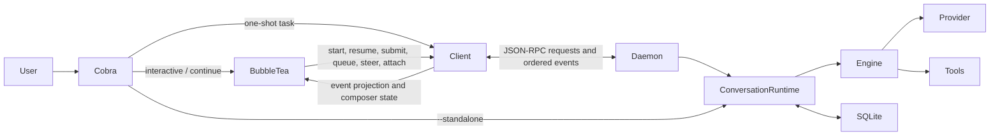

# Milestone 9: Interactive Terminal UI

* **Author:** hoangndst
* **Status:** Approved
* **Date:** 2026-11-21

## Overview

Milestone 9 gives Buddy an interactive Bubble Tea terminal interface for a continuing agent conversation. Cobra remains the command router, and the daemon remains responsible for conversation history, tool execution, and turn state. The TUI presents that state, accepts follow-up prompts, and reconnects to conversations without owning the agent loop.

The no-argument `buddy` command starts a new conversation. `buddy <task>` remains a one-shot task. `buddy --continue` resumes the latest conversation in the current workspace. Inside the TUI, `/resume` opens a project list followed by that project's conversations. The existing `buddy resume [id]` keeps its meaning: resume an interrupted or failed task.

When a turn is running, a new prompt is queued by default. The user can explicitly steer the active turn. The interface shows queued prompts and pending steering input as separate states.

## The Problem

Buddy currently has a line-based REPL and a daemon-backed one-shot task path. The REPL looks conversational, but every call to `Engine.Run` creates a fresh history. A follow-up prompt therefore cannot use the earlier turns as context. The daemon worker also runs the engine once and releases it when that task ends, and the daemon protocol has no operation for appending another turn to the same conversation.

The existing terminal path does not provide a persistent transcript, a composer that remains available across turns, a project-scoped conversation picker, or separate queue and steer actions. Each follow-up currently starts a new history. The earlier design also reserves incremental text streaming for this milestone, while the current provider interface is unary. M9 must address both the interactive workflow and the session/turn behavior beneath it.

## Goals

* Start a Bubble Tea interface when `buddy` is run without a task in an interactive terminal.
* Keep each accepted prompt as a distinct user message in one conversation. A prompt submitted while idle or queued starts an agent turn; an accepted steering message joins the active turn at the defined model-input boundary.
* Resume the latest conversation in the current workspace with `buddy --continue`.
* Let users browse projects and then conversations through `/resume` inside the TUI.
* Keep `buddy <task>`, `buddy attach`, and `buddy resume [id]` available with their one-shot, daemon-reattachment, and interrupted-task-recovery meanings.
* Queue a prompt by default while the agent is working and provide an explicit steering action. Show both kinds of pending input distinctly.
* Render assistant text, incremental text updates, tool activity, and turn status without blocking terminal input. Render and answer permission requests only with controller authorization and pending-request recovery enforced by the daemon.
* Let a client detach without stopping active work, reconnect with ordered event replay, and distinguish detaching from interrupting a turn.
* Preserve sequential line input for redirected streams and provide matching conversation behavior under `--standalone`.
* Keep the conversation usable after compaction, persistence restore, daemon restart, and client reconnect without losing or duplicating user turns.

## Non-Goals

* Replacing Cobra or the daemon architecture.
* Running multiple active conversations in one TUI window in the first version.
* Automatically resuming a previous conversation whenever bare `buddy` is launched.
* Changing the existing `buddy resume [id]` interrupted/failed task-recovery contract.
* Changing the existing tool permission policy or adding new approval categories.
* Claiming token streaming without implementing it through both provider adapters and the daemon event stream.

## Critical User Journeys

### Start a conversation and continue across turns

* **Given**: The user runs `buddy` in a terminal with daemon support.
* **When**: They submit a prompt, receive progress, then submit another prompt while the first turn is active.
* **Then**: Both prompts belong to one conversation; the second is queued by default, visible as pending, and runs after the first turn. The user can explicitly use `/steer <prompt>` to add input at the next model-input boundary.

### Resume a conversation

* **Given**: The user has persisted conversation history in one or more workspaces.
* **When**: They run `buddy --continue` or select `/resume` and choose a workspace and conversation.
* **Then**: Buddy restores the last durable history and accepts another prompt. Bare `buddy` still starts fresh, and `buddy resume [id]` retains task-recovery behavior.

### Reconnect after leaving the TUI

* **Given**: A turn is active or a permission request is pending.
* **When**: The client detaches, loses its socket, or attaches again with its last event cursor.
* **Then**: Agent work continues after detach; replay is ordered and reports gaps; the current turn and any still-valid permission request are shown. A daemon restart interrupts the active turn at the last durable boundary and rejects stale approvals.

### Use Buddy without a full-screen terminal

* **Given**: The user supplies redirected input, an explicit task argument, or `--standalone`.
* **When**: Buddy runs without an interactive TTY or without daemon transport.
* **Then**: Line-oriented and one-shot command behavior remains available, while repeated line prompts under the bare command share one conversation history.

## Resolved Design Constraints

* A **conversation** is the user-facing, root-level history that can contain multiple prompts. A **submission** is one accepted user prompt with a stable client-generated ID. An **agent turn** is one execution cycle started by a submission; steering input may join the active turn at the next model-request boundary. Existing SQLite `sessions` rows represent task executions, and existing `turns` represent ReAct steps.
* Keep the existing SQLite `sessions` table and IDs. Add `interaction_kind` with values `task` and `conversation`; migration 003 marks every pre-M9 row as `task`. New M9 conversations are depth-zero records. `/resume` and `--continue` select only depth-zero `conversation` records. Child/subagent sessions and legacy task rows are excluded. Keep `buddy resume [id]` for interrupted or failed task recovery. New APIs expose `conversation_id`; existing session APIs and events may retain `session_id` as a compatibility alias.
* The client checks daemon capabilities before using M9 conversation methods. If an older daemon is running, it reports that the daemon must be restarted; it does not stop active work or fall back to an independent agent process.
* Queue is the default. `/steer <prompt>` is the explicit alternate. Both are durably admitted before acknowledgement and remain visible until acknowledged. A steer does not cancel an in-flight provider generation or an already-returned tool call. It is appended before the next provider request; if the active turn ends first, it becomes the head of the next-turn queue. Steers are ordered by submission time and precede ordinary queued prompts.
* If `--continue` finds no conversation in the current workspace, it exits with guidance to start a fresh conversation using bare `buddy`.
* Workspace identity is the canonical absolute path. A moved or renamed directory appears as a new project entry; history recorded under the former path remains selectable.
* Keep workers resident while a turn or permission request is active. Apply the existing 50 completed-worker cap to all idle conversation workers, attached or detached; active turns and pending approvals pin their workers and are excluded from eviction. Evict the least-recently-active idle worker, release its in-memory runtime resources, and restore from SQLite when resumed. Before evicting an attached idle worker, notify its clients with `conversation.evicted`; the client keeps the conversation ID and transparently resumes and syncs before its next action. Conversation data follows existing database retention/pruning. Daemon restart restores the last durable turn boundary; pending approvals only survive reconnects while the daemon worker remains alive, and stale approvals after restart are rejected.
* Give each worker lifetime a unique `worker_epoch`. Event cursors contain `(worker_epoch, sequence)` and event IDs are monotonic within that epoch. A cursor from an earlier epoch causes full sync rather than ring-buffer replay. Persist a monotonic `history_revision`, advanced atomically with each durable transcript commit. `conversation.sync` registers the subscriber and captures the event watermark and committed `history_revision` under the worker's event-ordering lock. Its response includes conversation and active/terminal turn state, transcript pages at that revision, pending approvals when the worker is alive, and the event cursor. Transcript pagination remains pinned to the returned revision; the event cursor is independent of the durable history boundary. The client deduplicates events through the watermark, then replays later events in the same epoch. If a prior epoch or evicted transient deltas cannot be reconstructed from durable history, sync marks displayed output incomplete.

## Open Questions

No product or architecture decisions remain open for this draft. Implementation must confirm provider stream cancellation and error mapping against the pinned OpenAI SDK version and test terminal behavior across supported operating systems.

## Technical Plan (Architecture)

### Fixed Flow

Cobra continues to choose the command surface. A bare interactive `buddy` run starts a new TUI conversation; `--continue` asks the daemon or standalone runtime to resume the latest conversation in the current workspace; `buddy <task>` runs one turn and exits. The TUI sends user actions through the daemon client. The daemon serializes conversation turns, owns the active history and tools, and emits ordered events. The TUI updates its view from those events and remains responsive while RPCs and provider calls run. `--continue` cannot be combined with a task argument.

`buddy --continue` and `/resume` use persisted conversation metadata scoped by workspace. `/resume` first lists projects, then conversations in the selected project. The existing `buddy resume [id]` path continues to recover interrupted or failed execution.

The TUI keeps queue and steer as different operations. Queue is the default while a turn is active and is delivered after the active turn finishes. A steer is persisted immediately, but does not cancel an active provider generation or a returned tool call; the worker appends it before the next provider request. If the active turn finishes first, the steer moves to the front of the queued prompts. The UI keeps distinct pending previews until the daemon confirms acceptance. Interrupting a turn and detaching a client remain separate controls.

The existing daemon ring buffer remains bounded. Notifications carry conversation ID, turn ID, and an event cursor composed of worker epoch and sequence, so the client can deduplicate reconnect replay, detect gaps, and distinguish one turn's completion from the conversation's continued availability. On a gap or epoch change, the client calls `conversation.sync`; subscriber registration and event-watermark/history-revision capture are atomic with event ordering. Sync returns durable transcript pages pinned to the committed history revision, current state, and pending approvals, then the client replays events after the watermark in that epoch. Sync marks transient output incomplete if the ring buffer evicted deltas that durable history cannot reconstruct. The daemon emits one authoritative terminal event per turn.

The provider boundary needs an incremental output path for both Chat Completions and Responses. The engine emits text deltas as display updates, while the final completed message remains authoritative. Partial visible output must not cause a provider retry that repeats tool side effects. Tool-call arguments are assembled before the engine dispatches a tool.

Non-TTY input keeps sequential line prompts and EOF behavior. `--standalone` uses the same multi-turn contract without the daemon transport. Permission prompts are part of the UI only after the daemon validates controller authority and restores pending requests after reconnection.

### Conversation-State Ownership

Use a narrow conversation runtime shared by daemon and standalone execution. It owns one conversation's `history.Session`, accepted submission chronology, persistence coordination, and turn admission. The daemon `SessionWorker` hosts that runtime and remains responsible for RPC control, client ownership, event replay, cancellation, and approvals. The engine executes one accepted turn against the runtime's history and remains responsible for provider calls, ReAct steps, tools, and compaction behavior.

This boundary lets daemon and standalone modes share the same turn and history semantics. It also keeps conversation lifecycle separate from an individual model/tool execution. Turn execution stays in `Engine`, while transport and controller state stays in `SessionWorker`. `Engine.Run(ctx, task)` remains a one-shot compatibility wrapper and persists `interaction_kind=task`; legacy `session.start` also remains a task path. Only interactive multi-prompt entry points create `interaction_kind=conversation` records. The wrapper must not make one-shot tasks eligible for `--continue` or `/resume`. Resume rebuilds a conversation runtime from the persisted snapshot and steps.

The alternatives were reviewed against Buddy's current architecture. Keeping history directly on `Engine` would reduce initial code movement, but would keep conversation state and turn admission coupled to an object currently shaped around one-shot ReAct execution and leave daemon input ordering split across components. Rebuilding all context from SQLite before every turn would require reconstructing compacted history and reconciling interrupted writes on every submission. The selected runtime keeps active state in memory and uses SQLite for durable restore.

### Related Design Work

With the conversation runtime selected, M9 also needs an additive daemon operation for follow-up turns, persistent user-turn records distinct from ReAct step records, stable submission IDs for retry safety, and a correction to the compaction rule that currently assumes the first retained user block is always the root task. Resume distinguishes a completed chat conversation from the existing interrupted-task recovery command. The detailed implementation section specifies the streaming, queue/steer acknowledgement, older-daemon, and permission recovery contracts.

## Alternatives Considered

* **Replace Cobra with a TUI framework.** Not selected for M9: Cobra already owns command selection and flags. Bubble Tea can run within the interactive command without replacing the existing CLI surface.
* **Run the agent loop inside the Bubble Tea model.** Not selected for M9: coupling provider/tool execution to terminal lifecycle would complicate detach, reconnect, and non-TTY operation. The TUI submits actions to the shared runtime and renders its events.
* **Keep conversation history directly on `Engine`.** Not selected for M9: this reduces initial code movement, but makes engine lifetime the conversation boundary and leaves turn admission and persistence behavior split between Engine and SessionWorker. The narrow conversation runtime is shared by daemon and standalone modes.
* **Rebuild the complete conversation context from SQLite before every turn.** Not selected for M9: every submission would require reconstructing compacted history, tool results, and interrupted writes. SQLite remains the durable restore source, while active conversations keep their history in memory.

## Non-Functional Requirements

* **Security and privacy:** Keep daemon communication on the existing local socket and peer-credential boundary. Redact stored prompts, tool arguments, and errors using existing persistence redaction. Validate controller ownership for every submit, steer, interrupt, and permission response; reject stale turn/request IDs.
* **Responsiveness and memory:** Keep Bubble Tea updates free of blocking RPC/provider work. Bound daemon replay and client event queues by count and encoded bytes, keep each notification below the existing 1 MiB frame limit, and signal event gaps rather than silently losing terminal state.
* **Compatibility and recovery:** Keep existing one-shot and task-recovery commands. Add protocol capabilities without changing old request shapes; detect an older running daemon and give a restart-required error without stopping it. SQLite migration 003 is additive and must read existing v1/v2 data.
* **Failure handling:** Persist an accepted prompt and idempotency key before acknowledgement. Never retry a request after visible text deltas; after daemon restart, resume only from committed history and reject approvals tied to the interrupted worker.

## Additional Resources

* `docs/designs/05_universal_model_protocols_and_ux.md` — M5 event contract reserving `EventTextDelta` for M9.
* `docs/designs/06_sqlite_state_persistence.md` — existing session, turn, snapshot, and migration model.
* `docs/designs/08_unix_socket_daemon.md` — current socket, controller, detach, and event replay contract.
* [`.dev/docs/design_draft.md`](../../.dev/docs/design_draft.md) and [`.dev/docs/m9_principal_engineer_review.md`](../../.dev/docs/m9_principal_engineer_review.md) — M9 intent and harness architecture research.
* [`.dev/docs/m9_principal_engineer_followup.md`](../../.dev/docs/m9_principal_engineer_followup.md) — principal-engineer review of the detailed design findings.
* [Codex app-server](https://developers.openai.com/codex/app-server/), [OpenCode CLI](https://opencode.ai/docs/cli/), and [OpenCode session APIs](https://opencode.ai/docs/build/plugins/server/) — public examples separating session/turn state from terminal presentation.
* [Codex thread-store design](https://github.com/openai/codex/blob/main/codex-rs/thread-store/README.md) and [local store implementation](https://github.com/openai/codex/blob/main/codex-rs/thread-store/src/local/mod.rs) — Codex keeps canonical local transcript history in JSONL rollout files and uses SQLite for queryable thread metadata when available. This documents a split storage boundary; Buddy's SQLite trajectory store remains the basis for M9 persistence.

## Future Improvements

* Multiple live conversations in one TUI window are outside M9. The conversation and turn IDs in this design leave room for a later session switcher without changing the execution contract.

## Detailed Implementation Plan

### Runtime and interaction contract

* Add a `Conversation` runtime shared by daemon and standalone paths. It owns one history session, accepted submission chronology, submission deduplication, turn ordering, and persistence coordination. The engine executes one turn against that runtime. `Engine.Run` remains a one-shot wrapper.
* A fresh TUI shows an empty composer and creates a conversation on the first submitted prompt. The client generates a stable `start_id` before calling `conversation.start`. In one transaction, the daemon creates the conversation, persists the first prompt/submission, and stores the `(workspace_path, start_id)` creation key and payload fingerprint. A retry after a lost acknowledgement returns the existing conversation and turn; reusing the same key with a different prompt or mode returns conflict. Later submissions use a stable client-generated `submission_id` scoped to the conversation; repeating the same ID and payload returns its original result, while a changed payload conflicts and never starts another turn.
* Give each accepted prompt a `turn_id`. Conversation events retain a monotonic `event_id` and include both conversation and turn identity. A turn ends with exactly one terminal event; the conversation worker remains available for the next prompt.
* While idle, a submitted prompt starts immediately. While busy, Enter queues the prompt FIFO. `/steer <prompt>` durably admits steering input without canceling an in-flight provider generation or a tool call already returned by the provider. After that generation and any returned tool call/result are committed, append the steer before the next provider request. Steers are processed in submission order and before queued prompts. If the active turn produces its terminal answer before reaching another model request, promote the steer to the front of the next-turn queue. Show the tradeoff in the UI: an already-requested tool may still execute, or the active turn may finish before the steer affects it. Keep queued and steering drafts visible separately until server acknowledgement. Interrupt affects only the active turn; detach only disconnects the client.
* Persist every accepted user prompt before acknowledging it, then persist engine steps and outcome. A submission record contains a stable ID, prompt/mode fingerprint, FIFO sequence, optional associated turn ID, and admission/delivery status. Enforce unique `(conversation_id, submission_id)` in the same transaction that persists the accepted prompt and allocates queue order. Same ID and same payload returns its existing result/status; same ID with a different prompt or mode returns a conflict. Submission states are queued or steer-pending, attached to a turn, then consumed; turn state records running and terminal outcome. Each durable transcript commit advances a per-conversation `history_revision` atomically with its records. Resume restores the last snapshot plus later committed steps and all user-submission records. A crash marks the active turn interrupted at the last durable boundary. `buddy resume [id]` keeps its existing interrupted-task recovery behavior.
* `buddy --continue` resumes the most recently updated root conversation for the canonical absolute current workspace. `conversation.resume` accepts a workspace with no conversation ID to select that latest conversation, or an explicit ID from `/resume`. If none exists, report that fact and exit with guidance to run bare `buddy`; do not silently start a new conversation. `/resume` lists workspace paths, then root conversations within the chosen workspace. A moved or renamed directory is a new workspace entry; the old path and its history remain selectable.
* Persisted conversations remain resumable after daemon restart subject to existing database retention/pruning. Keep workers resident while a turn or permission request is active. All idle workers, including attached ones, count against the existing cap of 50 completed workers; eviction releases runtime resources and attached clients resume from SQLite before their next action. The TUI negotiates protocol capabilities at connect. If an already-running daemon lacks M9 conversation support, show this message: “This daemon does not support M9 conversations. Restart it when its current work is safe to stop, then retry.” Do not stop it or silently fall back to another execution path. A pending permission request remains valid only while its original daemon worker is alive; restart interrupts that turn and rejects stale responses.
* Bare `buddy` launches Bubble Tea only when stdin and stdout are terminals. Redirected input retains sequential line prompts with one shared conversation. `--standalone` uses the same `Conversation` runtime and persistence directly without daemon IPC.
* Provider adapters emit normalized text deltas and a canonical completed response. Tool-call arguments are buffered until complete before tools run. Auto-protocol fallback is allowed only before any visible delta; after visible output, a stream failure ends that attempt without replaying the request. The final completed response is authoritative and rendered once.
* Event buffers are bounded by count and encoded bytes. Replay reports the earliest retained `(worker_epoch, sequence)` cursor; a client cursor from an older epoch or before retained events calls `conversation.sync`. The daemon registers the subscriber and captures the event watermark and durable `history_revision` under the same event-ordering lock. Sync returns conversation/turn state, transcript pages pinned to that history revision, pending approvals if the worker remains alive, and the independent event cursor. The client deduplicates through the watermark and replays later events in the same epoch. Mark transient output incomplete if it cannot be reconstructed from durable history. Never silently drop terminal results or permission requests. Permission requests and responses carry conversation, turn, and request IDs; only the current controller may respond, and pending requests are replayed on reattach.

### Delivery phases

Each phase ends with a successful build and its focused tests before the next phase starts.

1. **Persistence and history:** Add the additive migration, conversation/submission records, idempotent admission, list/restore queries, and appendable history. Verify migration/backfill, uniqueness, ordering, compaction, and restore.
2. **Runtime, engine, and standalone:** Add the shared conversation runtime, per-turn engine entry point, task compatibility wrapper, turn outcomes, and standalone multi-prompt behavior. Verify history continuity, queue/steer admission semantics, compaction, and recovery.
3. **Daemon and client:** Add capabilities and conversation RPCs, worker lifecycle/eviction, queue/steer ordering, sync watermark recovery, event replay, and typed client operations. Verify controller checks, restart behavior, idempotent retries, and resynchronization.
4. **Provider streaming:** Add normalized streaming to both provider adapters and the engine, preserving unary compatibility. Verify deltas, tool argument assembly, cancellation, fallback before output, and no replay after visible output.
5. **TUI and CLI:** Add Bubble Tea, command routing, resume picker, attach behavior, and non-TTY/standalone surfaces. Verify responsive updates, terminal behavior, existing command compatibility, and the cross-platform build matrix.

### Implementation task breakdown

The file-by-file implementation tasks and focused test inventory are maintained in [`.dev/docs/m9_implementation_plan.md`](../../.dev/docs/m9_implementation_plan.md). This design retains the architecture, behavior contracts, delivery phases, and verification plan.

### Verification Plan

* **Build:** `go build ./...` and cross-compile with `CGO_ENABLED=0` for `linux/amd64`, `linux/arm64`, `darwin/amd64`, `darwin/arm64`, and `windows/amd64`, matching the M8 supported-target matrix.
* **Unit and integration tests:** `go test ./...`; run `go test -race ./...` for concurrent event delivery, turn admission, and cancellation.
* **Conversation behavior:** In a TTY, submit two prompts and confirm one conversation ID and prior context in the second provider request. Repeat through daemon and standalone paths. Drop the `conversation.start` reply and retry with the same `start_id`; confirm the original conversation and first turn are returned once. Reuse that ID with a changed payload and confirm conflict. Repeat duplicate and changed-payload checks for later submission IDs. Confirm one-shot `buddy <task>` and legacy `session.start` remain `interaction_kind=task` and are not selected by chat continuation. Queue multiple prompts and confirm FIFO order. Steer during generation and during a tool call; confirm the current generation/tool result completes, the steer is appended before the next provider request, and the tool is not canceled. If the active turn ends first, confirm the steer moves to the head of the next-turn queue ahead of ordinary queued prompts.
* **Persistence and recovery:** Compact and restore a multi-turn conversation; restart the daemon between turns; resume completed, failed, and interrupted conversations; confirm no user message is skipped or replayed twice. Test SQLite migration from v1 and v2, confirm legacy rows backfill to `task`, and confirm task/subagent rows are excluded from chat continuation. Confirm `history_revision` advances atomically with durable transcript commits and can pin sync pagination. Confirm the 50-worker cap evicts least-recently-active idle workers whether attached or detached, while active turns and approvals stay resident; verify an attached client receives eviction notice and resumes from SQLite before its next action.
* **Events and permissions:** Reconnect using cursors within and older than retained history and across worker/daemon restarts. Confirm epoch mismatch triggers full sync, atomic sync watermark/revision capture, transcript/state/approval snapshot, event deduplication and replay after the watermark, gap reporting, and incomplete-output marking for evicted deltas. Confirm terminal and permission delivery, controller-only mutations, and rejection of stale permission responses. Confirm detach leaves work running and interrupt stops only the active turn.
* **Streaming:** Exercise Chat Completions, Responses, and auto mode, including fragmented tool-call arguments, cancellation, fallback before a delta, failure after a delta, and final text. Confirm tools execute once and the final answer appears once.
* **Terminal and compatibility:** Verify resize/scroll/composer behavior, `/resume` workspace then conversation selection, `--continue` latest-in-workspace behavior, empty-history error, redirected line input, and unchanged `buddy <task>`, `buddy attach`, and `buddy resume [id]` behavior.

*Drafted with EGM*
